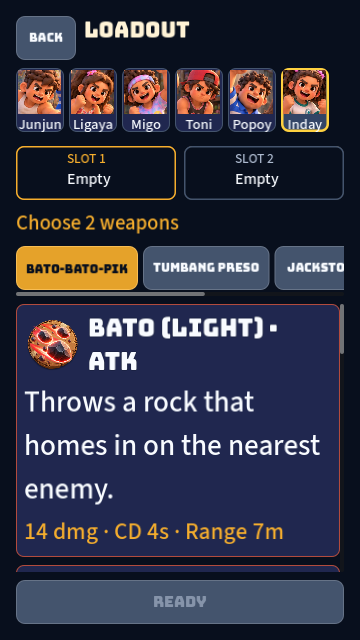
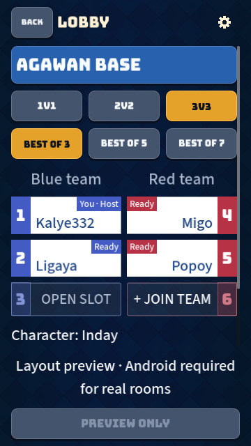

# Short-phone GUI follow-up

This pass addresses the GUI audit's first two priorities: crowded loadout browsing and a local-player marker lost through name truncation. Based on main `f9c8c33`.

## Changes

Loadout removes repeated Practice/Character labels, keeps character names on compact 3:4 portrait buttons, and places the timed auto-pick explanation under the heading. Portrait touch width remains 96 design pixels, above the 88-pixel minimum. Weapon art is larger; a display heading, full-width effect and separate stats row establish hierarchy without reducing reading-text sizes. Selection copy is shorter; slots and Ready remain visible outside weapon scrolling. Safe margins use the existing shared metric consistently.

Lobby names contain only the name. You appears in the independent status badge, including You · Host and You · Ready, so ellipsis cannot remove local identity. Team numbering, host/ready rules and room behavior are unchanged.

## Validation

Godot 4.6.2 import and Web PCK export completed without script errors. The full GUT run reported 463 passing tests, no failures, and the same three pending mesh checks for Toni, Popoy and Inday as unchanged main. Headless null-material errors, deprecated test calls and exit leak diagnostics also occur on the unchanged baseline; this pass does not fix those unrelated diagnostics.

New regression coverage verifies first-weapon stats within the short-phone scroll area at 100/120/140%, the timed setup explanation at 140%, retained reading size and touch width, fixed Ready placement, slot replacement and long-name local identity on either team across Host/Ready/unready states. The tests reproduced the relevant failures against the unchanged source before passing with the fix.

Rendered inspection used the changed Web PCK with the deployed Godot 4.6.2 single-threaded Web runtime, served locally. Screens inspected: 390 × 844 at 100%, 360 × 640 at 140%, and 720 × 1280 at 140%. A full fresh HTML/WASM template export was not run. The local gstack review checked changed code, connected UI consumers, accessibility scaling, touch dimensions, timeout/back/swap behavior and existing regressions. No simulation, input protocol, weapon data, export presets or runtime dependencies changed.

## Phone check after merge

At https://earl-gh.github.io/kalyeah/, wait for Pages to finish. Set Text size to 140%, open Practice, browse every weapon tab, select two weapons, replace each slot and start. Return to Home and inspect a Hotspot preview or a real Android room: confirm You stays visible beside Host/Ready even with a long name. Check timed Online setup separately against a running server. Android safe areas, physical touch behavior and real multiplayer remain device checks.

## Remaining GUI audit work

Shared icon/card styling, fixed-size action/HUD text, Profile navigation, unavailable-map previews and home grouping remain follow-up work. The current Bungee/Source Sans 3 and logo are retained pending reconciliation with the earlier Dagsen/SF Pro and home-branding requests. No new art was generated.
