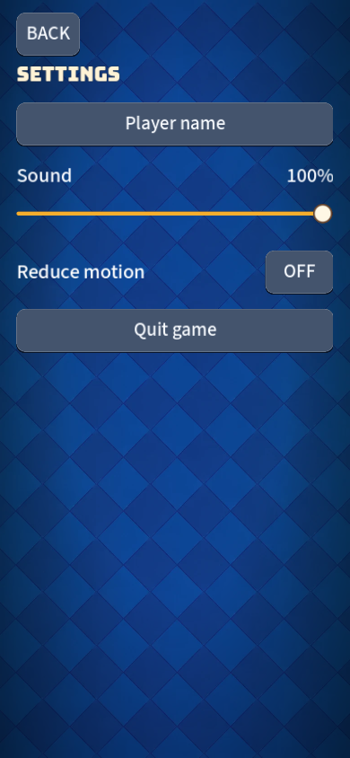
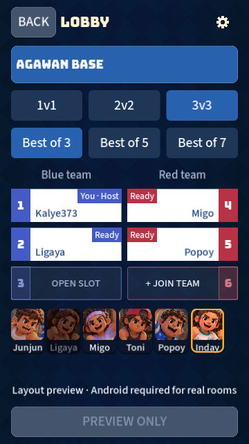
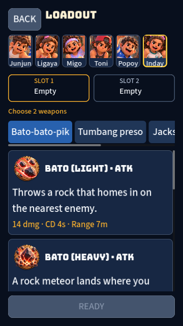

# UI simplification and density

Owner direction: remove text-size settings and unnecessary complexity; use Apple-inspired hierarchy, restrained controls and intentional negative space. This supersedes the reading-size behavior recorded in the earlier accessibility/loadout audits.

Text-size controls, persistence loading, live font scaling and per-label size exceptions are removed. Existing saved size values are ignored. Reduce motion, focus navigation, safe-area handling and confirmation behavior remain.

Actions use the readable body face; Bungee remains for display headings/HUD identity. Buttons retain 88-design-pixel touch height (44pt at the 360pt reference), with lighter borders/elevation. Back, Copy and weapon-tab labels use the common action size. Selection controls use calm surfaces with a blue active state; weapon cards use the shared palette. Slider art is smaller without shrinking its touch area.

Home artwork, mode and description form one group, with open space before the bottom actions. Settings groups sound with its slider, removes size controls and labels the rename action Player name. Lobby character cards match loadout sizing; captions no longer compete with faces or repeat the selected name above the strip.

## Validation

Godot 4.6.2 import, full GUT suite and Web PCK export checked locally. The obsolete scaling tests were replaced with coverage for ignored legacy values and retained motion behavior; layout, slot replacement, identity, navigation and network selection checks remain. The network integration test now checks the actual selected-character frame rather than the removed duplicate label.

The full suite reports 461 passing, zero failures and the same three pending mesh checks. Existing headless material/leak diagnostics remain. A changed Web PCK is inspected with the matching deployed single-threaded runtime at 360 × 640, 390 × 844 and 720 × 1280. This does not certify physical Android touch, safe areas, GPU performance or a fresh full HTML/WASM template export.

## Review on phone after merge

At https://earl-gh.github.io/kalyeah/, wait for Pages. Check Settings has no Text size; change sound and Reduce motion. Open a 3v3 room/preview, choose characters and check active choices. Open Practice, browse every weapon tab, replace both slots and confirm Ready stays reachable. Check Online code copying and timed setup with a running server. Hotspot remains code-free.

No dependencies, game art, gameplay rules or network protocol changes.
