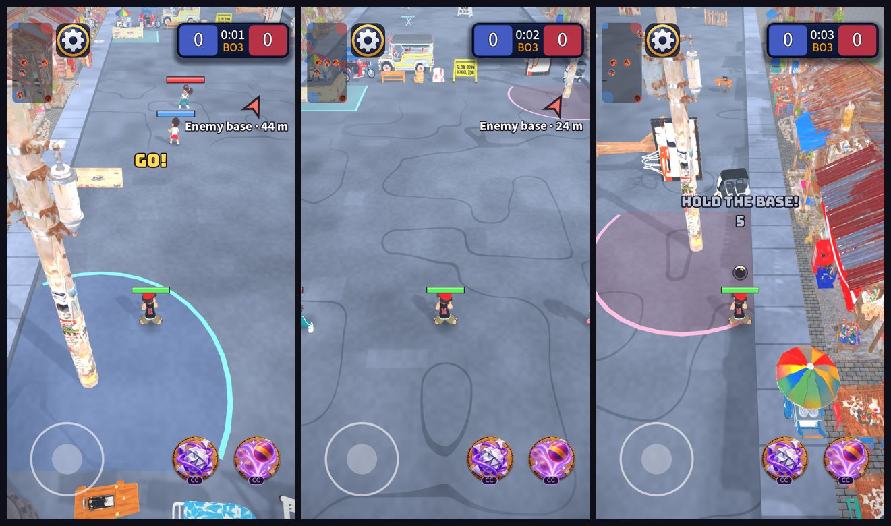

# Camera: higher and pitched forward

> **Superseded by [2026-10-20-camera.md](2026-10-20-camera.md).** The "kids are about 4% smaller" note below is wrong: at 46° / 12 m the kid was about a third smaller on screen (9.7% to 6.5% of the screen height). The numbers in the table are no longer the ones in use.

Owner request: more height and a more forward pitch for a better MOBA view. Data only (`data/rules/camera_rules.tres`):

| | Before | Now |
| --- | --- | --- |
| Pitch (degrees down from horizontal) | 32 | **46** |
| Metres of street visible across the screen | 11.5 | **12** |
| Camera distance from the aim point (720x1280) | 13.3 m | 13.9 m |
| Camera height (720x1280) | 7.1 m | **10.0 m** |
| Look-ahead of the aim point | 3.5 m | 3.0 m |

Left: at your base. Middle: the middle of the street. Right: at the enemy base. The top of the screen is now street (about 57 m ahead of the aim
point), no longer sky.

## Notes

- **Kids are about 4% smaller** (the street is 12 m wide on screen instead of 11.5). I widened it a little so the higher view does not feel closer to
  the hero than before. It is `visible_width`; set it back to 11.5 and the kids are as large as before.
- **You see less far up the street and more of the ground around the hero**, which is what a top-down MOBA view is. The danger of a steeper
  camera is a tall prop (the post) covering more of the screen right next to the camera: the post in the left picture is the biggest example.
- **The camera numbers are three lines of data**, so "a little higher" or "a little flatter" is a one-line change: `pitch_degrees` (46) and
  `visible_width` (12). 56 degrees is what the League reference uses; 46 is between the old 32 and that.
- Two camera tests changed with the geometry (the look-ahead, and "no sky at the top").
- Not on a phone: whether 46 degrees is the right amount is something to feel in the hand.
