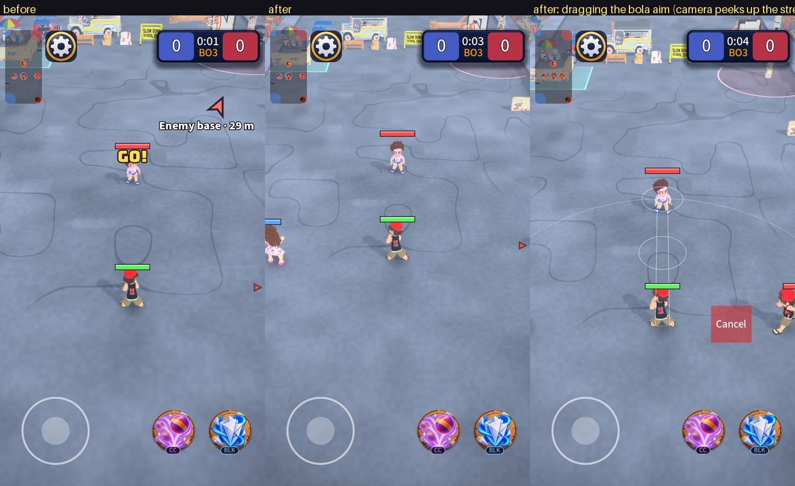
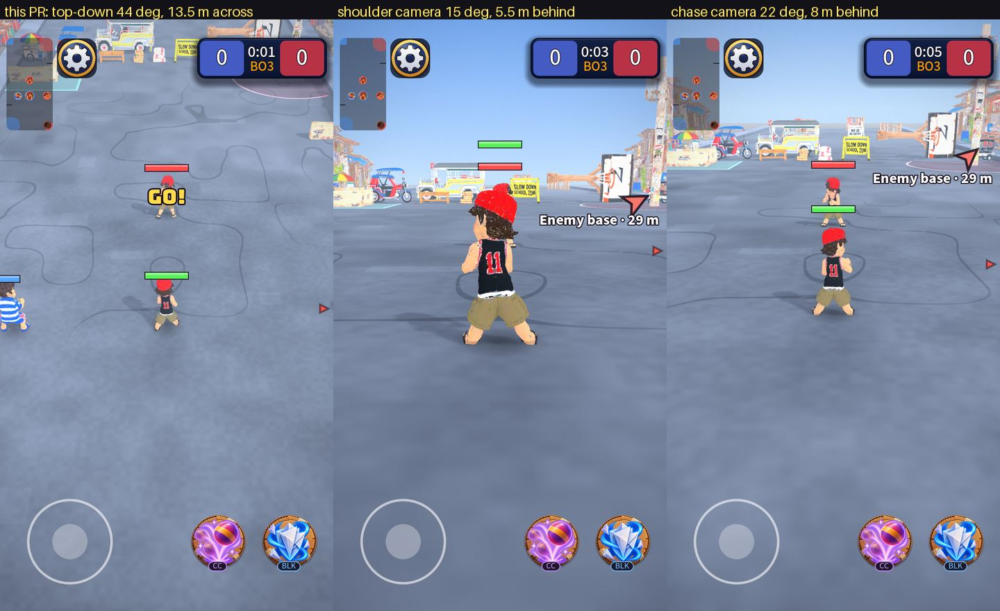

# Camera visibility for a vertical MOBA, and why not a shoulder (battle royale) camera

Owner questions: how do we get the best visibility for the player in a vertical MOBA (landscape is the ideal ratio for seeing the area, but this game is portrait), and
is this the best point of view, or should we try a third-person battle royale camera like CODM, Fortnite or PUBG?

## The problem is the sides, not the distance

A portrait screen is narrow, and weapons reach 7 to 9 m (rock, slippers and lata 7; heavy rock and spinning top 8; bola 9). I measured how much of the circle
around the kid is on screen (the bottom 12%, under the thumbs, not counted):

| Camera (kid height on screen about 100 px) | Street across at the kid | 5 m circle on screen | 8 m circle on screen |
| --- | --- | --- | --- |
| **Before:** 42°, 10.6 m across, kid at 62% of the screen height | 9.2 m | **51%** | **26%** |
| Kid at 50% of the height | 10.6 m | 100% | 29% |
| 14 m across, kids as they are (they shrink to 76 px) | 12.1 m | 100% | 35% |
| **Now:** 44°, 13.5 m across, kids drawn 1.35x, kid at 52% | **13.2 m** | **100%** | **61%** |

A throw from the side or from behind could land before you saw who threw it, while the top of the screen showed 42 m of street that no weapon can reach. Portrait
has surplus in the long direction and a shortage in the short one, the opposite of landscape.

## What changed (all data, `data/rules/camera_rules.tres`, plus small view code)

1. **The kid sits at 52% of the screen height (was 62%).** You see about 10 m behind you instead of 5.7, and still 44 m ahead. Free.
2. **Street 13.5 m across (was 10.6), kids and thrown objects drawn 1.35x** (`kid_view_scale`), so they keep their size on screen (about 100 px). The kid's hit area is
   the real size and the same for every kid: the ring under a kid and the weapon shapes are not scaled, the health bar rides on the drawn head. Pitch is 44° (was 42°)
   so the ground circles stay round (0.72) after the kid moved up the screen.
3. **Aim peek.** While you drag an aim by hand the camera eases up to 4 m toward where you aim (half the weapon's reach) and back on release. A tap that auto-aims
   and Reduce motion do not move it. (`peek_fraction`, `peek_max`, `peek_rate`)
4. **Threat ticks.** A small red tick on the screen edge for each enemy within your longest weapon's reach plus 2 m that is off screen (the nearest four; none while
   tagged or for an enemy hiding in its box). It is the same idea as the base chevron.

## Third-person (shoulder, chase) camera: measured, and no

I put a shoulder camera (15°, 5.5 m behind) and a chase camera (22°, 8 m behind) through the same measurements and the same scene:

| Camera | Kid | Street across at the kid | 5 m circle on screen | 8 m circle on screen | Ground circle (height / width) |
| --- | --- | --- | --- | --- | --- |
| **Now** (top-down) | 102 px | 13.2 m | 100% | 61% | 0.72 |
| Shoulder 15°, 5.5 m | 482 px | **2.9 m** | 18% | 15% | 0.47 |
| Shoulder 15°, wide lens (80°) | 359 px | 4.0 m | 26% | 21% | 0.30 |
| Chase 22°, 8 m | 260 px | 5.2 m | 26% | 18% | 0.46 |
| Chase 30°, 11 m | 176 px | 7.1 m | 47% | 24% | 0.54 |

Why it does not work here:

- **The field of view is the whole reason it works in CODM, Fortnite and PUBG, and portrait takes it away.** Those games are landscape: a 60° vertical lens gives about
  91° of horizontal view. In portrait the same lens gives **36°**. A shoulder camera in portrait sees a thin slice straight ahead and almost nothing at the sides or
  behind you (18% of the 5 m circle).
- **The weapons are ground shapes.** Landing circles, wedges and lanes are read from above. From a low angle a ground circle is squashed to 0.3 to 0.5 of its height
  (top-down: 0.72), so you cannot judge where a throw will land or who a cone will catch.
- **There is no aim to point with.** Those games aim by turning the view (a look stick, a crosshair) and shoot straight. Kalyeah's weapons are dragged on the ground and
  released; a third-person view would need a second thumb for the camera on top of the stick and two weapon buttons.
- **Props hide the fight.** The street has a tall post, a truck and houses; a low camera is blocked by them and shows sky and rooftops above the street.
- **The kid fills the screen** (482 px of 1280 at 5.5 m), and the thing it hides is the enemy ahead.

What a shoulder camera is good at (the feeling of being the character, immersion, seeing a character's back) is real, but it is the opposite of what a MOBA needs, which
is a map read. If you want that feeling, the opening show and the victory shot are the places (the intro already flies low).

## What is left (not done)

- The **bottom of the screen under the thumbs** hides about 2% of the ground; nothing to fix.
- **3:4 devices**: the camera keeps the street width, so a wider screen shows less street ahead. Keeping the visible height constant instead would show more street across
  on wider screens. Not changed.
- **Not tested on a phone.** The kid scale (1.35x) is the part that changes how the game looks; if the kids look too big next to the props, `kid_view_scale` is one
  number (the street width follows: 13.5 m at 1.35x, about 12 m at 1.15x).
