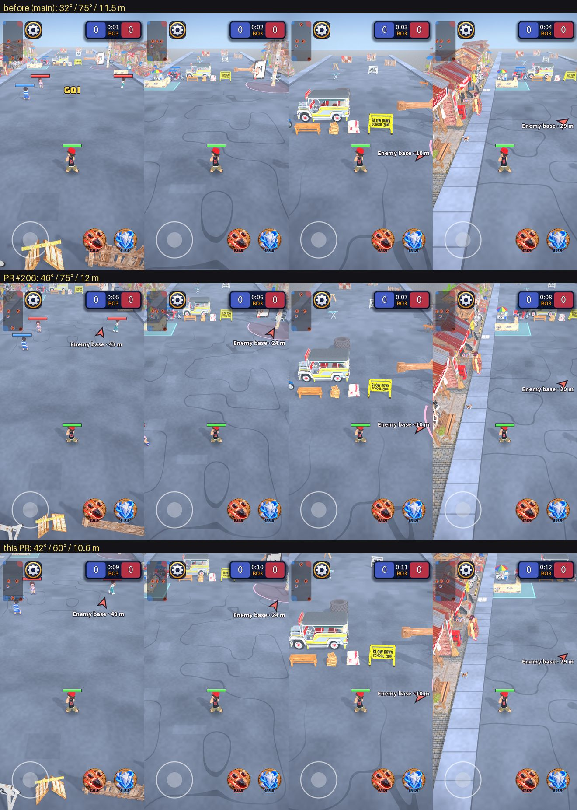

# Camera for a vertical MOBA: pitch, height, distance, zoom and yaw chosen together

Owner request: optimise the camera (height, pitch, distance to the kid, zoom, a slight yaw if it helps) for a vertical MOBA, so a new player has little
to learn and the eyes do not tire. The numbers below are measured (`tools/camera/analysis.py` is the same maths as `scripts/view/camera_rules.gd`),
not guessed, because the settings fight each other.

## What changed (data only: `data/rules/camera_rules.tres`)

| | Before (main) | PR #206 | **This PR** |
| --- | --- | --- | --- |
| Pitch (down from horizontal) | 32° | 46° | **42°** |
| Vertical field of view (zoom) | 75° | 75° | **60°** |
| Street visible across the screen at the aim point | 11.5 m | 12 m | **10.6 m** |
| Camera distance / height (720x1280) | 13.3 m / 7.1 m | 13.9 m / 10.0 m | **16.3 m / 10.9 m** |
| Yaw | 0° | 0° | **leans -8° to +8° toward the hero's side** (0° in the middle) |
| **Kid height on screen** (of the screen height) | 9.7% | **6.5%** | **8.1%** |
| Street visible across the screen at the kid's own row | 8.9 m | 10.2 m | **9.2 m** |
| Ground circles (the weapon rings) height / width on screen | 0.75 | 0.89 | **0.80** |
| Street shown ahead of the aim point (to the top of the screen) | sky (no ground) | 60 m | 42 m |

Rows: before, PR #206, this PR. Columns: own base, middle, enemy end, by the curb. The kid is at the same screen position in all of them.

## Correction to PR #206

PR #206 said the kids would be "about 4% smaller". That was wrong. The kid on screen is shorter than the kid is tall, because a steeper camera sees a
standing kid from above (foreshortening), and the street width I only nudged from 11.5 to 12 m. Measured, the kid goes from **9.7% to 6.5% of the screen
height, a third smaller**. A tiny kid is the opposite of "easy to learn": it is harder to see who is who, which way they face and what they are doing.
This PR keeps most of the steeper view and gives back most of the kid's size (8.1%).

## How the decision was made

Every setting moves the others, so I fixed the one thing a new player reads first (the kid) and solved for the rest.

1. **Kid size is the anchor.** A kid under about 7.5% of the screen height (96 px of 1280) is hard to read on a phone. The width of visible street is
   set for each pitch and lens so the kid stays near 8%. That is why "higher" cannot just mean "more pitch": each degree of pitch has to be paid for with
   a narrower view (a closer zoom).
2. **Pitch 42°.** Steeper makes the ground read as a map (weapon rings look like circles, the stick direction matches the screen direction), flatter
   makes the kids look like people. The grid below shows that going from 36° to 52° at a constant kid size costs about a quarter of the street you see
   around the hero (10.6 m to 7.7 m across at the kid's row), and the ground circles only get about a quarter rounder (0.74 to 0.92). 42° is where the circles pass 0.8 without the view around the hero shrinking
   below the old one (9.2 m versus 8.9 m).
3. **Lens 60° instead of 75°.** A wide lens stretches things near the edges of the screen (a kid at the side looks bigger and tilted), which the eye keeps
   correcting for: that is the eye fatigue and the "getting used to it" the owner described. 60° is still wide, with a gentler stretch toward the edges. The camera
   ends up farther away (16.3 m) and higher (10.9 m), which is the height the owner asked for, and does not change how the game plays.
4. **Distance and zoom** are the same thing here: the distance is derived from the visible width, so 10.6 m across means 16.3 m away.
5. **Yaw: a lean toward the hero's side (changed after review; 0°, +8° and -8° tried first).** I first kept 0° because turning the camera does not add playable area: for 48° / 60° / 9.2 m, the share of the 20x17 m area
   around the kid that is on screen:

   | Kid | Yaw 0° | Yaw 20° |
   | --- | --- | --- |
   | in the middle of the street | 50.8% | 52.8% |
   | by the left curb | 62.6% | 47.8% |
   | by the right curb | 62.6% | 78.2% |

   That was the wrong question: the owner's concern was that 0° *looks* narrow, like a corridor, and area does not measure that. A fixed yaw (+8 or -8) fixes the look but
   favours one side, exactly the table above. The owner's answer is better than either: **switch the yaw gradually with where the kid is**, -8° on the left of the map and
   +8° on the right, easing through 0° in the middle. The camera then always sits on the hero's side and looks a little *inward*, across the street (the case that
   gained 15 points in the table, on both sides), and never wastes view on the sidewalk. The street shows depth at the curbs, where the corridor look was strongest;
   in the dead middle it is straight. The turn eases with the camera (never a jump), stick and aim follow the yaw on screen, and the camera aims along the way it looks,
   so the hero stays on the screen's centre line. An earlier version of this note also said a yaw "breaks the mirror between the teams": that was wrong, the other team's
   view is the same camera turned 180° and the street is symmetric under that turn.

## The grid behind it

Kid held at about 7.5% of the screen height (hero 64% down the screen), yaw 0. Columns: `w` metres of street across the screen at the aim point,
`high` camera height, `ahead` metres of street visible ahead of the aim point, `wide@h` metres across at the kid's row, `circle` ground circle
height / width, `threat` share of the 20x17 m area around the kid on screen.

| pitch | fov | w | high | ahead | wide@h | circle | threat |
| --- | --- | --- | --- | --- | --- | --- | --- |
| 36 | 60 | 13.0 | 11.7 | 99 | 10.6 | 0.74 | 65.9% |
| 40 | 60 | 11.9 | 11.8 | 56.5 | 10.0 | 0.79 | 61.5% |
| 44 | 60 | 10.8 | 11.6 | 37.7 | 9.3 | 0.84 | 57.6% |
| 48 | 60 | 9.7 | 11.2 | 27.1 | 8.5 | 0.88 | 53.2% |
| 52 | 60 | 8.7 | 10.6 | 20.3 | 7.7 | 0.92 | 48.3% |
| 44 | 75 | 11.0 | 8.9 | 71.9 | 9.0 | 0.90 | 60.7% |

The chosen 42° / 60° / 10.6 m sits between the 40° and 44° rows (kid 8.1% instead of 7.5%, a little more kid for a little less street).

## Notes

- **A tradeoff you can see:** you see about 5% less of the area around the kid than before (57.6% against 63.1%), because the kid is held larger relative to
  the street than in PR #206. The things you lose are the corners of the screen, which the minimap and the edge arrows already cover.
- **Not changed:** the hero at 62% down the screen, the follow speed, the stick and aim mapping (a stick pushed diagonally at 45° shows at about 52° on screen,
  56° before, so it is closer to what the thumb did, not further), the hitboxes (nothing about gameplay).
- **Not tested on a phone:** the numbers come from the camera maths and the pictures; the feel (is 42° right in the hand) needs a few minutes on the
  live link. Every number is one line of data, so a flatter or steeper try is `pitch_degrees` and `visible_width`.
- **Tests:** `tests/unit/test_camera_rules.gd` now pins the kid size (at least about 8% of the screen height), the street width at the kid's row
  (at least 9 m), the shape of ground circles and the yaw, so a later "just a bit higher" cannot quietly shrink the kids again.
