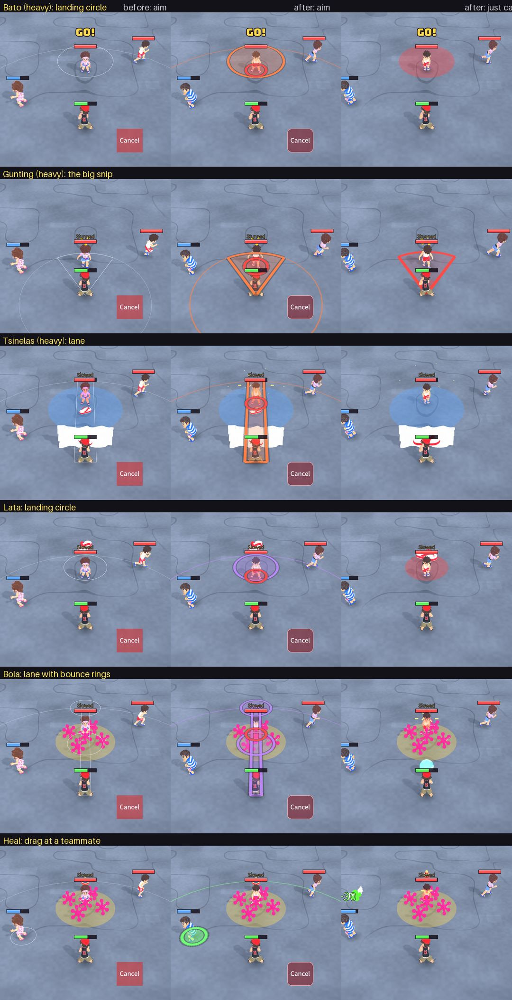

# Gameplay audit: how a cast looks and feels, and what was still plain

Owner request: the skill-cast hover (the aim preview) is still plain; look for other rough gameplay design that is still lurking, then improve it.

Method: I put every one of the 14 weapons through the same scene (an enemy in front, a teammate beside, 720x1280), took the aim preview and
three frames after the cast (0.13 s, 0.43 s, 0.83 s), and read the code that draws each. Before, after and the findings are below.

Left: before. Middle: the same aim now. Right: just after the cast.

## What was rough (found), what changed (this PR), what is left

| # | Finding | Why it hurts | Now |
| --- | --- | --- | --- |
| 1 | **Aim previews were 1 px white hairlines**, no fill, one colour for every weapon, a 45% range circle: on the light grey street the shape was hard to see, and on a phone it nearly vanished | the cast hover is the moment the player decides; if the shape is unreadable they cast blind | Filled area with a **thick rim in the weapon's type colour** over a dark under-line (reads on any ground), thin range circle, slow breathing pulse (off with Reduce motion) |
| 2 | **No sign of who the cast will hit** | the player had to judge a 2 m circle or a 3 m wedge by eye | A **ring under every kid the cast would reach right now** (red enemy, green heal patient), from the same tests the real hit uses (`WeaponSystem.would_reach`; a test compares it with a real cast) |
| 3 | **No "nothing will happen" state.** Releasing the homing rock with nobody in range, or a heal dragged at nobody, silently casts nothing | looks like the weapon is broken; the player waits out a cooldown that was never spent | Preview goes **grey** when a release would cast nothing (`WeaponSystem.would_cast`), **red** over Cancel |
| 4 | **The big snip (Gunting heavy, 24 damage) had no warning at all**: 0.5 s after the cast it lands, and nothing on the street says where | the one hit that can take a quarter of your health arrives from nowhere. The rock's landing circle is a warning; the snip should be too | A **red wedge on the ground for everyone**, filling outward from the caster until the strike; gone if the caster is tagged first. New `cone_winding` sim event, relayed online like `cone_struck` (no rule changed) |
| 5 | **Hit-and-run feedback was missing**: a rock, a slipper or a snip landing showed nothing on the street except the kid's flinch and a thin bar drop (there is a hit sound) | the game feels weightless; you cannot tell hit from miss on a fast exchange | **A short flash and sparks on a kid who is hit**, sized by the damage (a tick of damage is small). Still no damage numbers (owner rule); flash only with Reduce motion |
| 6 | **The snipping scissors' hold has no on-screen meaning**: 2 snips on a tap, +1 per 0.25 s up to 6, but nothing shows how many you will get | the "hold longer" mechanic is invisible, so players never discover it | **Six pips in the wedge; one more lights up for each snip you will get** |
| 7 | **The Cancel tile was a flat red rectangle** that does not react | the one control that stops a cast gives no feedback that the finger is on it | Quiet rounded red tile; **lights up and says "Let go to cancel"** while the finger is on it |
| 8 | **The paper wall / block of earth preview was a single line** | the wall is the one weapon where the exact position matters | A filled wall the real thickness, in the block colour |

### Still plain (not in this PR, ranked)

1. **A shield stopping a projectile is silent.** The sim just removes the projectile (there is no event), so the paper wall never reacts. It needs a sim
   event (relayed online) and a small ring-and-paper-bits effect. Biggest remaining feel gap.
2. **Statuses are small italic words over the health bar** ("Slowed", "Polymorphed"), 19 px, overlapping the bar in places. A coloured icon and a bar
   tint would read faster at phone size.
3. **A trap's trigger has no pop**: the paper ball becomes a blue disc between two frames. A short snap would tell the victim why they slowed.
4. **Jacks' five bright pink star clusters** are louder than anything else on screen (and the least readable as a hazard area, since the
   damage area is only a faint disc). It needs the owner's art direction (a Blender or sprite job, not something to generate).
5. **A boomerang or the spinning top has no catch/arrive cue** (the sim catches the slipper at 0.8 m silently).

## Notes

- **View only, no rule changed.** The two sim additions are read-only helpers (`would_cast`, `would_reach`) that reuse the existing hit tests (the cone test
  moved into one shared function so the preview cannot drift from the real hit) and one event (`cone_winding`).
- **Respected owner rules:** no damage numbers; Reduce motion turns off the preview pulse and the sparks; the cast stays on release; nothing is added to the weapons.
- **Not tested on a phone.** The bursts are deliberately small (a third of a second); if they feel too quiet or too busy on the real device the numbers are constants at the top of
  `scripts/view/weapon_fx_view.gd` (`BURST_*`).
- **Tests:** `tests/unit/test_cast_feedback.gd` (18 tests): the preview matches a real cast, the no-target cases, the colours, every weapon's preview draws, the
  wind-up warning appears and goes, the burst appears and goes, the cancel tile, the snip pips, the online relay of the new event.
