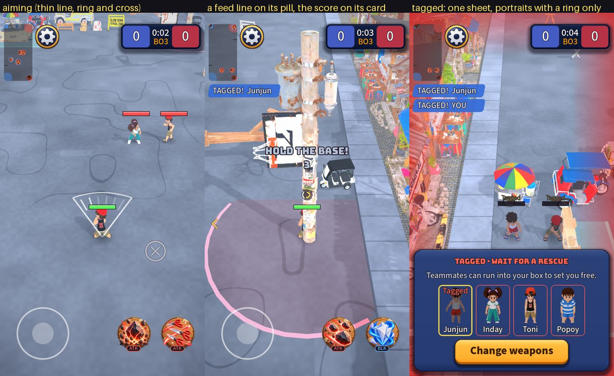

# Containers: where they earn their place, and where they were over-engineering

Owner feedback on the quiet-HUD pass: I removed containers from things that need them (the scoreboard, the feed lines) instead of from things that do not.
That was a mistake of method: I used "less is quieter" as the rule when the real question is "can this be read on the street without it".
This pass fixes it with a measured rule, brings back what was wrongly removed and removes the containers that were genuinely redundant.

## The evidence: the street is a mid grey

I rendered the street at 12 spots (both ends, the middle, against each curb, the corners) with the HUD hidden, then measured what white text would sit on at the
place each HUD element lives (white text contrast against the street behind it):

| Element | Median contrast of white on the street | Pixels under 4.5:1 |
| --- | --- | --- |
| Score | 2.8 | 96% |
| Feed lines | 2.9 | 98% |
| Skill type tags (15 px) | 3.6 | 97% |
| Hint line | 3.2 | 98% |
| Opening words | 3.5 | 94% |
| Settings gear | 2.8 | 98% |

The street sits around 30% luminance, so **white text is under 3:1 almost everywhere** (the small ones need 4.5:1, the large ones 3:1). A team-coloured number
(blue, red) is worse: the light blue I used for the score is about 1.2:1 against the street. An outline helps the edges but not the reading of small text at a
glance. So small state text really does need a container, and the quiet pass was wrong to take it away.

## The rule

| Kind of element | Container? | Why |
| --- | --- | --- |
| **Small state text read over the street** (score, clock, TAGGED!/RESCUED!, skill type tag, connection message) | **Yes** | the container guarantees contrast; the street cannot |
| **A group of controls or information that acts as one thing** (tagged sheet, menus, results, a coach bubble) | **Yes, one** | it says "these belong together" |
| **Big words with an outline** (opening words, GO!, capture countdown) | No | 40 px and up clears 3:1 with the outline, and they last seconds |
| **Things that are already a shape** (weapon buttons, stick, the gear's painted ring, the Cancel ring) | No | a second shape around a shape adds nothing |
| **Guidance on the ground** (aim line, base chevron) | No | it must not cover the field |
| **Anything inside a container** | **No second one** | in a card the words already have contrast |

## Decisions

### Brought back (they carry state text over the street)
1. **The scoreboard card** with its lit edge and the two team tiles.
2. **The TAGGED! / RESCUED! pills** (blue for your team, red for theirs).
3. **The pill behind the ATK / CC / BLK tag** under each skill (15 px text).
4. **The tagged sheet** (title, hint, portraits and the Change weapons button are one group, so one container).
5. **Victory / Defeat chips** on Home and History: a result is the status of the row and should stand out of its card.

### Kept removed (they were redundant)
1. **The dark square behind the settings gear**: the painted gear already has a gold ring (a container around a container).
2. **The plate behind the opening words**: 40 px with an outline, three seconds, over the controls.
3. **The second plate around the loadout sockets**: each socket is already the plate.

### Newly removed (a container inside a container)
1. **The filled boxes behind the portraits in the tagged sheet**: the sheet is the container. They keep a thin team-colour ring (it tells ally from enemy and
   shows they can be tapped) and the gold ring on the one watched.
2. **The solid pills for weapon type on the Book tiles and the weapon sheet**: they sit inside a card, and the tile's rim colour already says the type. They are
   coloured words now (`UiKit.tag`).

### Checked and left alone
I walked the home, Book, History, Settings, How to play, loadout and in-match trees looking for a styled box that almost fills a styled parent, and for a styled
box that holds only one label. Beyond the ones above there are none that are not deliberate: the History result chips inside their row cards, the Book's weapon
tiles (a type word and a round holder around a square icon), the How to play step numbers (numbers that must stand out), and the tab bar's sliding highlight.
The developer UI gallery has many but it is not a player screen.

## Tests

`tests/unit/test_containers.gd` pins the rule: a feed line sits on a pill with the team's colour, the scoreboard keeps its card, the gear and the opening words
and the loadout sockets have no extra container, and portraits in the tagged sheet have a ring but no fill. The two older tests that I had flattened are back to
asserting the sheet.

## Not done

- **Not measured on a phone.** The contrast numbers come from rendered screenshots of the street; a phone in sunlight is harder than that, which only argues for
  keeping the containers.
- If you want the weapon type to stay a pill on the Book tiles, it is one line (`UiKit.chip` instead of `UiKit.tag` in `weapons_page.gd`).
