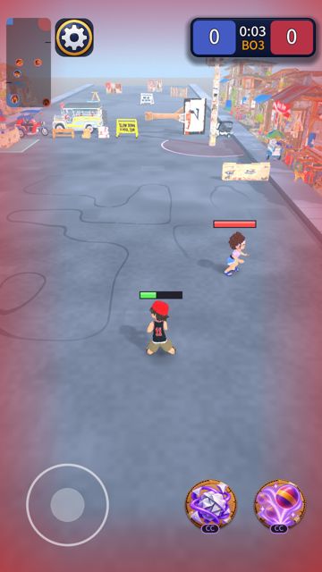

# Practice sparring partner

From [the audit](2026-10-20-next-audit-3.md), finding 2: Practice had nothing that fights back, so alone you could
never be hit, tagged, or pressed on a capture, and the weapons could never be balanced by playing.

## What shipped

- **`FightBrain`**, a training dummy that fights. It uses the same `PlayerInput` as everyone (press one tick,
  release the next, aimed), the match's own seeded RNG for its aim error, and no RNG of its own, so a fight is
  deterministic and testable.
- **Behaviour.** Waits at its spot until an enemy is within 14 m; then closes to a standoff (70% of its longest
  reach, 2.5 to 7 m), strafes, and casts a ready weapon when the enemy is in reach (a shield when the enemy is near, a
  heal tap on itself below half health). It fetches a tagged teammate when no enemy is within 7 m, and walks back
  to its spot when you leave.
- **In Practice** the patrol dummy is the sparring partner by default (`practice_fighters = 1`; 2 adds the standing
  one; 0 is the old behaviour). It gets a random pair of weapons with at least one that damages.
- All the tuning numbers are data (six now: `bot_skill` was added with the aim fix) (`game_rules.tres`): `practice_fighters`, `bot_aggro_range`, `bot_cast_gap`,
  `bot_aim_error_degrees`, `bot_standoff_share`.

## A first number (before the aim fix)

*These times are from the first version of the bot, which threw ground circles at full range and never led a target; [the balance duels](2026-10-20-balance-duels.md) explain the fix. The bot is now a little harder (`bot_skill` = 0.4).*

A bot with one damaging weapon and a heal, against a player standing still 6 m away, takes **20 to 50 seconds** to tag
them (bato light 29 s, bato heavy 49 s, tsinelas heavy 21 s, jacks 36 s, gunting heavy 38 s); weapons that mostly
slow, block or set traps (lata, bola, papel, lupa, trumpo) never tag alone in a minute. With **two damaging weapons** it
is much harder: slipper plus rock took 62 of a standing player's 100 health in 4 seconds (screenshot below). Moving
helps a lot, since the aim does not lead.

So how hard it is depends on its random weapons; the cast gap (1.6 s) and the aim error are the two numbers to change if it is too hard or too easy. It is also the first measured comparison between weapons
this project has, and it is not balance data yet (one bot, a target that does not move, a fixed range).

## Self-critique

- **It reverses "dummies never attack".** You did not say no to bots when I asked, and said to do what is best; the
  GDD line is rewritten and the whole thing is one number (`practice_fighters = 0` puts the old dummies back).
- **Bots do not count for captures**, as before. So the enemy bots can tag you and you can rescue and tag them, but
  they cannot score; Practice is still about your own flow, not a match you can lose.
- **The bot walks straight at you** and does not path round cover; behind a bench it can stand and cast into the
  wood. Acceptable for sparring; a real opponent would need pathfinding.
- **The aim is only a straight line** with an error. It does not lead a moving target, so a player who keeps moving
  is hit less than one who stands still.
- **The fighter's loadout is random each match**, so what you meet changes. A fixed choice would be easier to learn from.

## Next

A headless script that pits bot against bot (every weapon pair, many seeds) for real win rates, which needs the
bots to count for captures or a duel rule; that is what would settle D6, D10, D14 and D15.
