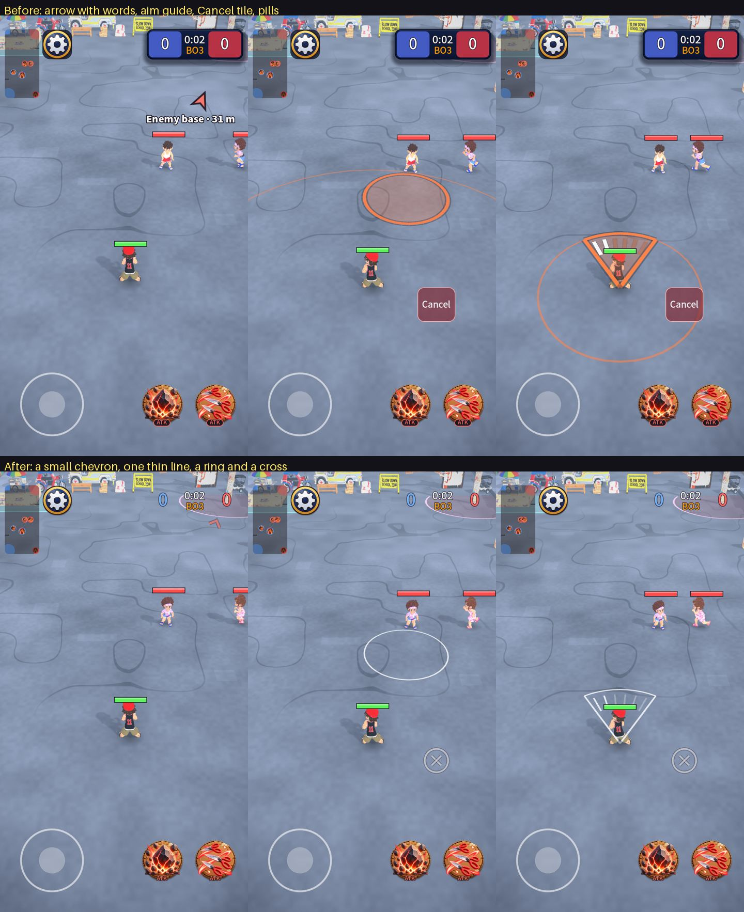

# Quiet HUD: less on the street, nothing behind things that do not need it

> **Correction:** this pass removed containers from the score, the feed lines, the skill tags, the tagged sheet and the result chips, which carry small text over a
> mid-grey street and need them. They are back; the rule, with measurements, is in [2026-10-20-containers.md](2026-10-20-containers.md). Findings 1 to 3, 5, 7 and 10 stand.

Owner request: the arrow to the enemy base and the skill-cast hover should be simpler (or none) and not spoil the player's view of the field; audit the other
components the same way, and remove elements that are not concise: unnecessary button containers and other container styling.

The rule I audited against: **in the match, nothing stands behind text or an icon unless it has to be read over any street, and nothing sits in the middle of
the field that the player did not ask for.** I looked at the live match in five states (idle, aiming a landing circle, aiming a cone, capture, tagged) and the
home, book and loadout screens.

Top: before. Bottom: after. Same scene, same moment.

## Findings and what changed

| # | Finding | Why it hurts | Now |
| --- | --- | --- | --- |
| 1 | **The aim guide I added last PR was too loud**: thick rim, 26% fill over the street, a range circle, a pulse, a different colour per weapon | it covers the ground you are trying to read while you decide; the owner is right that it should be simple or none | **One thin white line** (about 4 px), only while you drag by hand. No fill, no range circle, no pulse, no per-weapon colour. A tap that auto-aims draws only the thin ring under the kid it will hit. **Settings > Aim guide** turns it off completely |
| 2 | **The base arrow had words** ("Enemy base · 31 m", 26 px, thick outline) and sat 250 px in from the edge, in the middle of the field, right over the enemies | it is the most prominent thing on screen and says what the minimap already says | A **small thin chevron** at the edge (36 px from the sides, 150 px from the top), moved out of the minimap corner, 75% opacity, no words, no pulse |
| 3 | **The Cancel control was a red tile with a rim and the word "Cancel"**, and a second line under the controls said the same thing again ("Release to cancel") | two containers/texts for one idea | A **thin ring with a cross** and nothing behind it; it lights up red under the finger. The line under the controls says what letting go does |
| 4 | **Weapon-type tags (ATK / CC / BLK) sat in dark pills with a border** under every skill button | the icon's glow already shows the type; the pill adds a second shape to every button | Outlined coloured letters, no pill |
| 5 | **The settings gear sat on its own dark rounded square** although its painted art already has a gold ring | a container around a container | The art alone |
| 6 | **The score was a dark card with a lit edge and shadow, with two coloured tiles inside it** | four shapes (card, edge, two tiles) for two numbers and a clock | Outlined numbers in the team colour (blue left, red right) and the clock; no card |
| 7 | **The opening "TAG THEIR BASE!" words sat on a plate** over the controls | a card for three seconds of words that already have an outline | Words on the street, no plate |
| 8 | **TAGGED! / RESCUED! feed lines were skewed coloured pills** | colour already in the word | Coloured words, no pill |
| 9 | **The tagged view was a 430 px tall sheet with five bordered cards and a plate**, covering a third of the street while you are watching it | you are tagged to watch the field | No sheet, smaller portraits (96x144), no box on a portrait (only the one you watch has a gold ring), names in the team's colour; 360 px tall instead of 430 |
| 10 | **Menus: a second plate around the loadout sockets** (each socket already is a plate) | a container inside a container | The sockets only |
| 11 | **Menus: weapon type shown as a solid pill on every weapon tile, the weapon sheet, and Victory / Defeat on History and Home** | the colour and the word already say it | `UiKit.tag`: coloured words (a chip stays for numbers like the step numbers in How to play) |
| 12 | The big-snip warning of the cast-feedback PR | right in purpose, a bit heavy | Thinner edge (0.08 m) and a lighter fill (22%) on the warning. The burst is unchanged (a third of a second) |

## Kept on purpose

- **Cards that group something to read or tap:** the results card, the menus, the coach marks, the connection message (needs contrast on any street).
- **Health bars and their dark back** (a bar must read on any ground), the weapon button art and the joystick rings (they are the controls).
- **The "HOLD THE BASE!" countdown** (important, big and short-lived).
- **The minimap's see-through backing** (spec'd: 55% opaque, no frame).

## Not done (for the owner's call)

- **Menus still have many plates** (the home profile chip, the last-match chip, the page switch containers, the loadout card). They are a deliberate design
  system with a gallery, and a flatter menu is a style decision I did not want to make for you without a look. Candidates, in order: the home profile and
  last-match chips, then the two stacked segmented switches in the Book ("Characters / Weapons" and "By game / By type"), then the loadout weapon card border.
- **The base arrow could also be turned off** in Settings if you want it fully gone; it is one more switch next to Aim guide.
- **Not tested on a phone:** the thin line is about 4 px at 720 px wide; on a bright sunny phone it may need to be a little bolder. It is one constant
  (`AimIndicator.LINE_WIDTH`).

## Tests

`tests/unit/test_cast_feedback.gd` now pins the quiet rules (a thin line, no range circle, a tap draws only rings, the aim guide can be turned off, the
Settings page has the switch and the match menu does not so Resume and Leave stay in view, no panel behind the Cancel mark). Two older tests changed
because their subject is now flatter: the opening words have no card, and the tagged row has no sheet. The weapon type colour test now checks the words
read on the dark card (contrast 4.5) instead of white on a pill.
