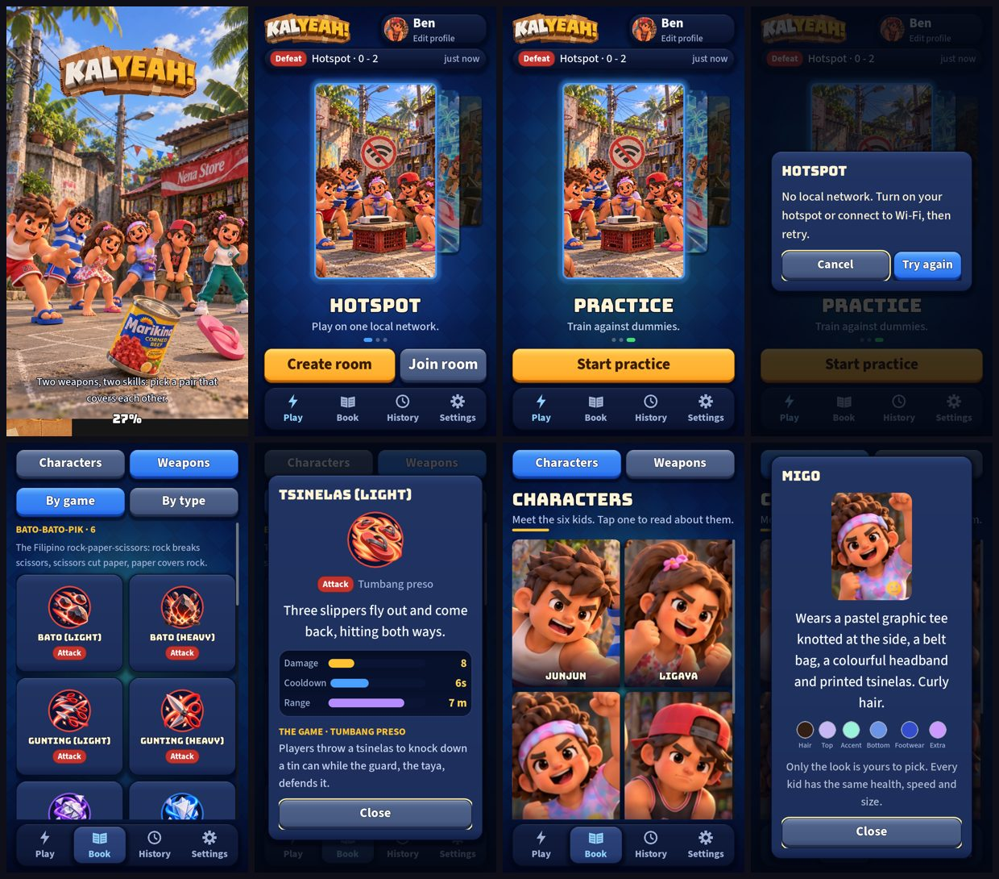
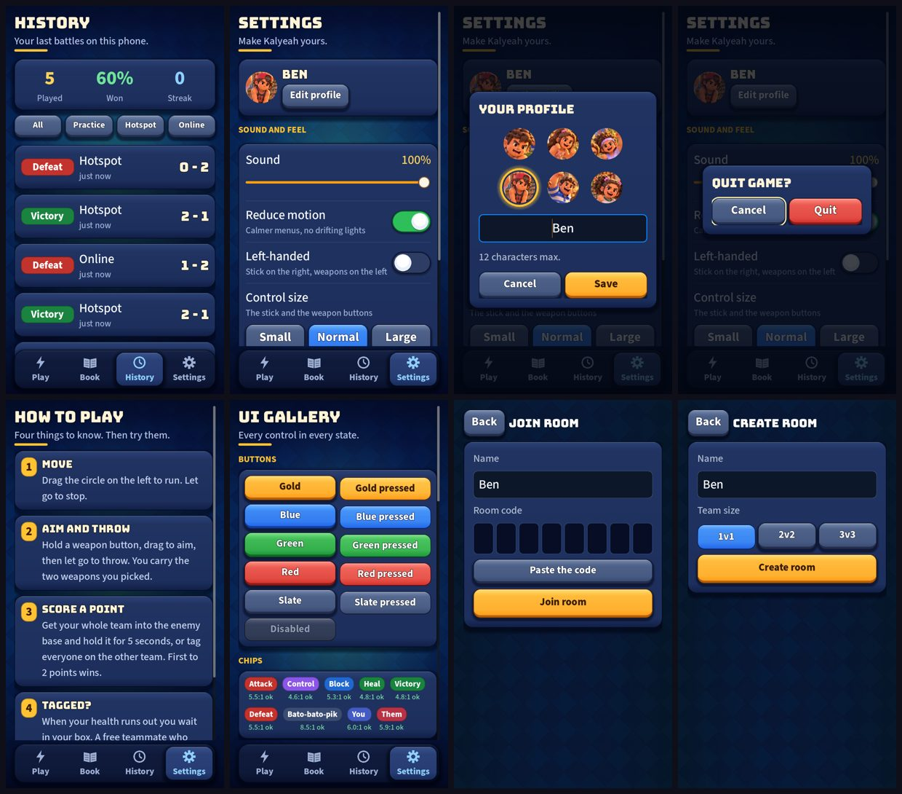
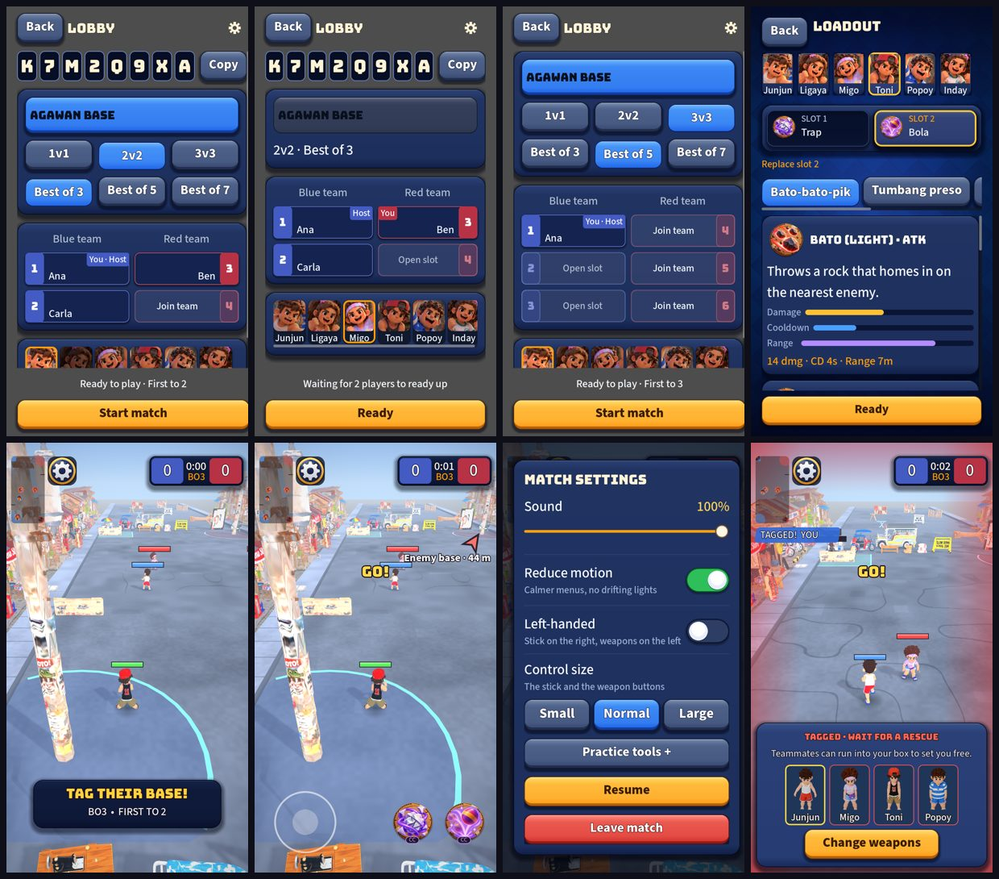

# UI audit 4: every screen against a "triple-A" bar

Written after round 14, from **screenshots of every screen at 720x1280** (the 30 states in the three images below),
a scan of every visible button and label for size, and a read of every player-facing string. Not seen on a phone:
that stays your check. Earlier audits looked at Home and the Book; this one is the first to look at all of it,
including the loadout, the lobby, the Settings page and the match.

The bar I used, for each screen: **hierarchy** (one clear thing to do), **detail** (the polish a player feels),
**components** (the same thing looks and behaves the same everywhere), **conciseness** (nothing says what the
screen already shows), **copy** (plain, consistent, true), and **aesthetic fit** (it looks like Kalyeah).

## Scorecard (1 to 5)

| Screen | Score | Why |
| --- | --- | --- |
| Boot | 4 | Strong key art and a clear bar; one tip is wrong (see C1). |
| Home | 4.5 | The best screen: one gold action, clear hero, tab bar. Practice's line is out of date after the sparring partner. |
| Book: weapons | 4 | Grouped grid, bars, the real game behind each weapon. Names have no scheme (F2). |
| Book: characters | 4 | Large, calm, a palette on the sheet. |
| History | 3.5 | Good summary; the filters and the last-match strip are under the touch minimum (F3). |
| Settings | 3.5 | Long; the name is forced to UPPERCASE here only; a developer page is listed (F7). |
| How to play | 4 | Short, numbered, true. |
| Dialogs | 3.5 | Consistent frame; a gold focus ring on touch (F6). |
| Join / Create room | 3 | Top-heavy: half the screen is empty and the action is mid-screen (F5). |
| Room (lobby) | 3.5 | Dense but clear; "Best of 3" above and "First to 2" below say the same thing twice, differently (C4). |
| **Loadout** | **3** | The weakest screen, for the moment that matters most (F1). |
| In-match HUD | 3.5 | Clear and uncluttered; the minimap is too small and the smallest text is in the match (F3, F4). |
| Match menu | 4 | Same pattern as Settings. |
| Tagged sheet | 4 | Says what to do and why. |
| Results card | 4.5 | A moment, not a form. |

## Findings, worst first

**F1. The loadout is a list of one-and-a-bit cards.** You choose two weapons out of 14 in a timed screen (10 s online)
by scrolling cards one at a time, so you cannot compare. The Book already has a grid that shows six at once. On the
card, the line "14 dmg · CD 4s · Range 7m" repeats the three bars above it. "Replace slot 2" is an instruction in a
colour that reads as a heading. The slots show a short name ("Trap") that is not the name on the card ("Papel Trap").

**F2. Weapons have no naming scheme.** "Bato (Light)", "Papel Trap", "Langit (Heal)", "Lupa (Soil Block)",
"Tsinelas (Heavy)". Buttons use "Bato H", "Gunting H", "Shield", "Trap", "Heal". The type tag says ATK, CC, BLK, HEAL
on a button and Attack, Control, Block, Heal on a chip: two words for crowd control, and "CC" is jargon a first-time
player has never heard.

**F3. Text and targets below the floor we set ourselves.** The scale says 24 px is the smallest step and 88 px
(44 pt) the smallest target. The scan found: weapon type tag on the buttons **15 px**, the weapon-type chips **20 px**,
palette labels **18 px**, the status word over a kid **19 px**, the gallery's contrast notes 20 px; and **History's four
filters 75 px tall** and **the last-match strip 64 px**. 15 px at 720 wide is 7.5 pt on a 360 pt phone.

**F4. The minimap is the least readable thing in the match.** 100 x 200 px of 720 (14% of the width, about 54 pt on
a 390 pt phone), a translucent grey box, faces 8 px in radius. It answers "where is everyone" for a player who has to
squint.

**F5. Join and Create are top-heavy.** Both fill the top half and leave the lower half empty; the gold action sits in
the middle of the screen, not where the thumb is.

**F6. Focus rings show on touch.** Every dialog opens with a gold ring on Cancel or Close. That is a second gold thing
beside the real action (Save, Quit), and it is only meant for keyboard and gamepad.

**F7. A developer page is in the player's Settings.** "UI gallery" is listed for everyone. The match menu's "Practice
tools +" is similar; it is useful, but it is a developer switch with a label that does not say so.

**F8. No screen-reader names, no localisation.** `accessibility_name` is used nowhere and there are 10 tooltips; no
string goes through `tr()`, so a Filipino version would mean editing every file. For a game themed on Filipino street
games that is a gap, not a detail.

### Copy (C)

- **C1.** The boot tip "Two weapons, **two skills**: pick a pair that covers each other." There are no skills any
  more (no dash, no pin). And "then **dash** in to capture it".
- **C2.** Practice reads "Train against dummies." One of them now fights back.
- **C3.** The player's name is "BEN" in Settings and "Ben" on Home and in the profile editor.
- **C4.** "Best of 3" and "First to 2" mean the same and appear together (lobby, the opening card, How to play).
- **C5.** Separators: "BO3 • FIRST TO 2" uses a bullet, everything else a middle dot. Loading texts use "..."
  in some places and "…" in others.
- **C6.** "Can't reach that address." Players never see an address; the server is built in. It should say what to do.
- **C7.** "Practice tools +", "Replace slot 2", "Lobby" (the page is a room) are labels that need a second read.

### What to keep

One gold action per screen, the skin, the Book's sheets with bars, the results card, the tagged sheet, the coach marks.
None of the findings above ask for a new look.

## Plan

Each round is small and testable. Rounds 15 and 17 need nothing from you but a yes; 16 and 18 need your call on the
decisions below.

| Round | Ships | Fixes | Check |
| --- | --- | --- | --- |
| **15 Words and floors** | The copy pass (C1 to C7), the name shown as typed, one separator, one ellipsis. A **type floor** (nothing under 22 px except where a test says so) and a **target floor** (88 px): History filters, the last-match strip, chips, tags. Focus ring only after the keyboard is used. **A UI lint test** that opens every screen and fails on text under the floor, a target under 80 px or a banned phrase, so this stays fixed. | F3, F6, C1 to C7 | Screenshots before and after; the lint test. |
| **16 The loadout** | A grid of weapon tiles like the Book's (six at once, tap to put in a slot, long-press for the sheet), the two slots always visible, one stat line not two, "Suggested" as one tap, the countdown always in view online. | F1 | Practice on the live link; online needs the server. |
| **17 The match at a glance** | A minimap that grows with the screen (and a size choice with the controls), higher contrast, bigger faces; "Control" on the buttons in full; overhead status at the floor; the direction label kept off the kids' bars. | F3, F4 | A phone: this is the one that needs eyes. |
| **18 Depth** | A **naming scheme** for the weapons (F2); the gallery behind a developer switch (F7); accessible names on every control and `tr()` on every string, with English as the only language until you want another (F8); an audible tick for the loadout countdown and the capture. | F2, F7, F8 | Reading the strings; a screen reader pass on a phone. |

Round 15 is the obvious next one: it is cheap, it fixes things a player sees in the first minute, and the lint test
means I cannot quietly break it later.

## Decisions for you

1. **Weapon names.** One scheme, for example "Bato · Light", "Papel · Trap", "Langit · Heal", short names "Bato", "Trap",
   with a mark for light and heavy instead of "H". Or keep what you have and I only make the short names match the long.
2. **"CC".** Call it "Control" everywhere, or something else you prefer. I would not keep "CC".
3. **Filipino.** Do you want the game's words in Filipino as well as English (a language switch)? Round 18 would build the
   structure; the translation is yours to write or approve.
4. **The UI gallery.** Hide it from players, or keep it as a "Look" page?
5. **The minimap.** Bigger on tall phones by default, or only if the player picks it?
6. **The loadout.** Is a grid of tiles what you want for a timed pick, or should it stay a list?

## Not covered

Anything that needs a phone in the hand (touch feel, safe areas on a real notch, speed); the animation and the sound of
moving between screens; the online flows with a real server; and the 16:9 and 19.5:9 shapes, which round 9 checked for
Home and the Book only.
