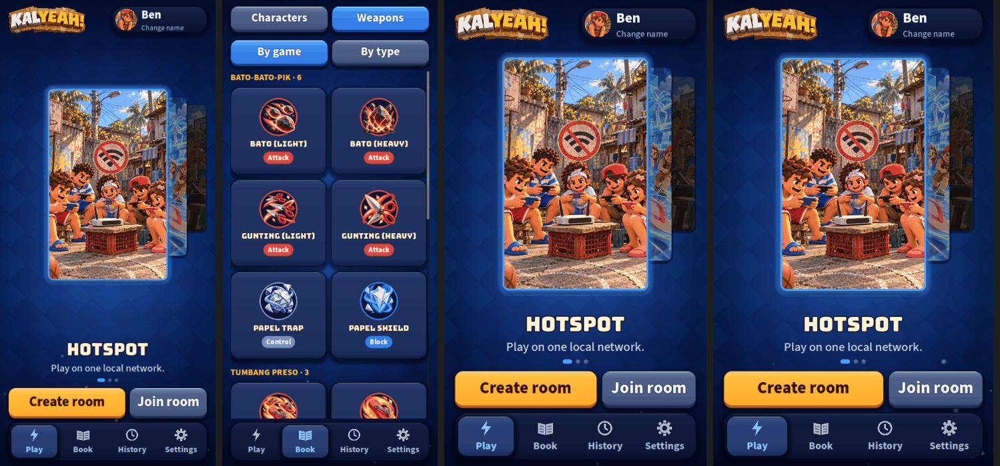
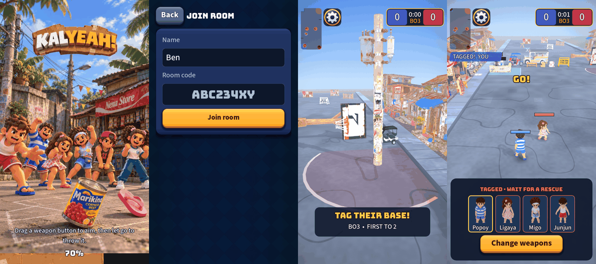

# UI audit and plan: what to improve after the rebuild

Written after #182 to #187 merged (the skin, Home, pages, Loadout, Book, results card). This is an audit and
a plan only: no code changes. Every number below was measured on this branch, headless or at the sizes stated,
by throwaway scripts (the method is under each finding). Nothing here was run on an Android phone.

## What was audited

| Area | How |
| --- | --- |
| Cost of the code-drawn skin | Timed the first build of every button and panel texture (`UiSkin`), and their memory. |
| Thumb targets and text size | Walked every visible button and label on 13 screens at 720x1280 (home, three pages, weapons, a sheet, a dialog, hotspot room, online create and join, loadout, HUD, pause menu). |
| Contrast | Computed WCAG ratios for the 16 text-on-surface pairs the skin uses. |
| Phone shapes | Rendered Home and Weapons at 390x844 (19.5:9), 360x780, 540x960, 600x1000. The project stretches with `canvas_items` / `expand`, so the design is 720 wide and as tall as the phone. |
| Screens not yet looked at | Boot, online join, the opening card, the tagged panel. |
| Consistency | Counted old flat styles and hard-coded sizes that bypass the skin and `UiMetrics`. |

## Findings, ranked

### 1. The skin may stall the first screen on a phone (risk, measured on desktop)
Each texture is drawn pixel by pixel in GDScript the first time it is used. On this desktop, headless:
**18 button textures take 225 ms, the 4 panel kinds 103 ms, and 9 extra corner radii another 164 ms** (23 textures,
695 KB, before the extra radii). That is about 12 ms per button and 26 ms per panel on a fast CPU. A mid-range
Android phone or the single-threaded web build can easily be 5 to 10 times slower, so Home could freeze for one
to three seconds the first time it opens, and again at the first dialog or Loadout. Not measured on a phone.
The cause is also wasteful: every texture is symmetric, so one quarter of it is enough, and nine radii are
mostly one-off variants.

### 2. Tall phones waste the hero (certain, measured)
The hero card is a fixed 400x640. At 720x1558 (iPhone 390x844 and most Android phones, the common case) the
card floats with about 300 px of empty space around it. The test phone shape (1280) was the only one tuned.
Short and tablet shapes are fine; phones taller than 16:9 are not.

### 3. Three chip colours fail contrast (certain, computed)
White 20 px bold text on the Heal chip is **2.41:1 (fail)**, Attack **4.11** and Block **4.14** (both under the
4.5 needed at that size). The green button label (3.66) and the loss-red result title (3.96) are only fine as large
text. Everything else (the muted text, tabs, gold figures, buttons) is 4.9 to 13.4.

### 4. Other screens still wear the old flat style (consistency)
The opening card ("TAG THEIR BASE!"), the tagged panel, the capture pill, the scoreboard frame and the
hotspot/online room rows are flat navy rectangles beside skinned buttons. 24 places still build flat styles by
hand and 25 font sizes and about 60 sizes are hard-coded instead of coming from `UiMetrics`.

### 5. Online create and join are bare (UX)
Join is a name field, an eight-box-less code field and a button on a mostly empty screen. There is no paste
affordance, the code is not shown as eight clear boxes, and errors are only text. Create is a name and a
size switch. They work and pass tests, but they are the first screens of the online flow.

### 6. The UI has almost no feel (polish)
One click sound and one back sound. No press "thunk", no tick when the carousel snaps, no sting under the results
card (the match audio plays one, but the card does not know about it), no menu music, and screens change with hard
cuts and a loading cover. The skin gives the buttons weight; the sound does not follow.

### 7. Idle motion may cost battery (unmeasured)
Home animates continuously (the card bob, the drifting motes) and `low_processor_mode` is off, so the menu
redraws at full frame rate even when nothing else changes, and the motes keep drawing under a page. Cheap on a
desktop; unknown on a phone.

### 8. Small items
The profile chip's "Change name" hint is 20 px (the rest of the app is 22 or more). The HUD's custom touch controls
(joystick, skill buttons) are not standard buttons, so this audit's scan did not cover them.

### What is fine (measured)
Every button on 13 menu screens is at least 80 px on both sides (88 is the design target; most are larger). No
text under 22 px on any menu screen except finding 8. Contrast is good everywhere except finding 3. The pause menu,
results card, dialogs and loadout all wear the skin.

## Plan

Four pull requests, in this order. Each is a meaningful chunk with tests; only the last needs a phone.

| # | Chunk | Fixes | How it is verified |
| --- | --- | --- | --- |
| **R7** | **Fast and fits any phone.** Bake the skin four times faster (draw one quarter, mirror it) and warm it behind the boot screen's loading bar instead of at the first tap; cut the nine radii to the three actually used. Scale the hero card to the stage height. Pause the motes and the card bob while a page or dialog covers Home. Fix the three chip colours and the 20 px hint. | 1, 2, 3, 7, 8 | A test that the new texture is pixel-identical to the old per-pixel draw; the same timing script before and after (target: at least 4 times faster); screenshots at the five phone shapes; contrast computed in a test. |
| **R8** | **The match chrome on the skin.** Opening card, tagged panel, capture pill, feed lines, scoreboard frame and the room rows move to `UiSkin` plates. Layout and touch controls stay where they are. | 4 | Existing HUD and room tests; before/after screenshots; no control moves by a pixel. |
| **R9** | **Online forms.** Join shows the code as eight boxes with paste and clear error states; Create gets a visual size picker and the room code shown big once made. | 5 | Tests for typing, paste, bad code, full room; screenshots. |
| **R10** | **Feel.** Synthesised UI sounds (press, carousel tick, results sting, back), a short fade between screens, and a one-line motion budget. All respect Reduce motion and the volume setting. No asset files. | 6 | Tests that every UI sound exists, is not silent and honours volume; Reduce motion has no fades. |
| After | **Phone pass on the match HUD** (joystick, skill buttons, scoreboard, minimap) and the owner's painted button art, both needing a device or the owner. | 8 | You install the debug APK; I adjust to what you see. |

### Decisions to confirm
1. **R7 first.** It is the only item that could make the game feel worse than before the rebuild on a real phone.
2. **Pre-warming at boot** adds work to the loading screen (the bar is already there). The alternative is to ship the
   skin as pre-rendered PNGs made once by a dev tool; that is faster still but adds binary assets to the repo.
   Recommendation: warm at boot, and only bake PNGs if the phone shows warming is still too slow.
3. **R9 reshapes the online forms.** Say if you want only the code boxes and not the Create redesign.

### Not planned, on purpose
Accounts, ranked, friends lists, stats and levelling (out of scope by design). Per-player match stats would need a sim
and design change first.
