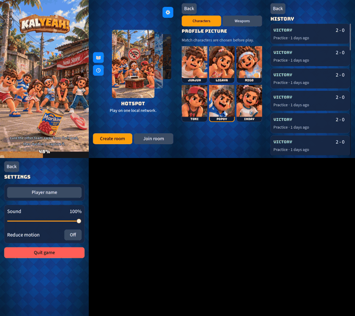
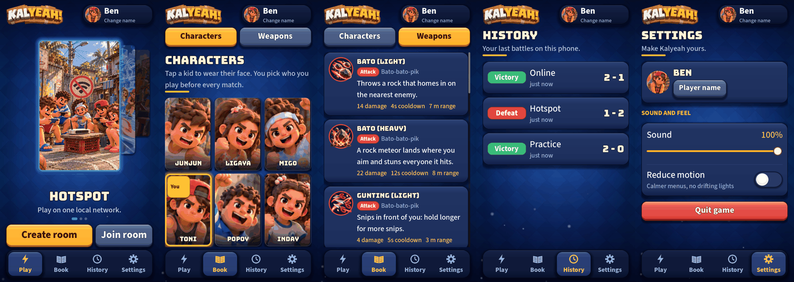
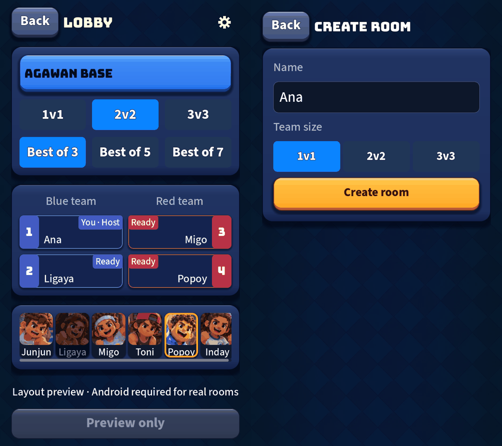

# UI rebuild: a code-drawn game skin, and a candid critique

Branch `feat/ui-rebuild`. Brief from the owner: *rebuild the interface to prioritise user experience and
aesthetics to match triple-A games, start from scratch, and criticise yourself in the process.*

## What I decided before touching anything (and where I might be wrong)

- **This contradicts the previous direction.** #180/#181 pushed the interface towards *restrained,
  Apple-like*. A triple-A mobile game (think the lobby of a Supercell or Riot title) is the opposite: glossy,
  chunky, lit, alive. I followed the newest instruction and say so here so the owner can overrule it.
- **"From scratch" means the look and the layout, not the contracts.** I kept everything the earlier passes
  earned and tests protect: safe areas, 88 px thumb targets, modal draw order, focus restore, reduced motion,
  the controller APIs (`open_page`, `open_name_editor`, `primary_button` ...). Throwing those away would have
  looked fresh and played worse.
- **No image assets.** CLAUDE.md says to advise, not generate. Every surface is drawn in code
  (`UiSkin`), so the owner's pictures (logo, cards, faces, backdrop) stay the stars and can still be swapped.

## What was built

| Piece | File | Idea |
| --- | --- | --- |
| Skin | `ui_skin.gd` | Buttons and panels are small anti-aliased textures rendered once from a rounded-rectangle distance field: gradient face, gloss, lit top edge, dark lip it sinks into when pressed, outline, soft drop shadow. Used as 9-slice style boxes. |
| Backdrop | `ui_backdrop.gd` | The owner's diamond picture, an accent glow that follows the chosen mode, a vignette and slow drifting motes (off with Reduce motion). |
| Kit | `ui_kit.gd`, `ui_tab_bar.gd`, `ui_segmented.gd`, `ui_toggle.gd`, `ui_profile_chip.gd` | Page header, cards, chips, setting rows, bottom tab bar, segmented control, animated switch, profile chip. |
| Home | `title_screen.gd`, `menu_carousel.gd` | Logo + profile on top, the mode carousel as the hero (chosen card framed in light and floating), the mode's name, one phrase and one big gold action under it, a tab bar. Tabs swap the middle; the chrome never moves. |
| Pages | `characters_page.gd`, `weapons_page.gd`, `history_page.gd`, `settings_page.gd`, `codex_page.gd` | Rebuilt on the kit. |
| Everything else | `kalyeah_theme.gd`, room cards | Buttons, panels, dialogs, the room's player rows inherit the skin. |

Before (left to right, top to bottom: loading, home, characters, history, settings):

After (home, characters, weapons, history, settings):

After, dialogs and rooms (hotspot check, rename, quit, hotspot room preview, online create):

## Self-critique

**What was wrong with the old UI (honestly).** It was tidy but flat: one weight of everything, no focal
point, a Back button on every page, flat rectangles with no feeling of pressing. The main screen was a card
stack leaning to one side with two small icon buttons floating on its left. Nothing said "game".

**What is still wrong with the new one.**

1. **The logo and profile chip repeat on every page**, and the page then adds its own big title. That is
   about 150 px of the 1280 spent on chrome the page already explains. A better answer is to collapse the top
   bar to the profile chip on pages and keep the logo on Play only. I did not do it because the tab bar
   already says where you are; it is the next thing I would change.
2. **The hero card is small.** At 372 px of 720 it leaves wide empty blue on both sides. The height budget (logo,
   titles, action, tab bar) decides it. A taller card would need the logo gone from Play, which is a brand
   decision, not mine.
3. **Gold is overused as "selected".** Segmented control, tab bar and primary action all go gold. It reads as
   consistent but costs hierarchy: the one main action per screen should be the only gold thing.
4. **Weapons page is long.** Three weapons per screen, each with a paragraph. A grid with a detail sheet
   would be more triple-A, and would also let the page hold more than six weapons.
5. **Procedural gloss is not painted art.** A per-pixel gradient is clean, but a real triple-A button has hand
   painted texture and bevel. The skin is built so that the owner's button art can replace the textures
   without touching any screen.
6. **Texture cost.** Every button/panel variant is a one-time texture render at first use (a few ms each). Cached,
   so not per frame, but I have not measured it on a low-end Android phone; it needs a check on the device.
7. **A bug my own test caught.** The first version of the pressed button had a smaller content height than the
   resting one, so any button inside a container shrank by 6 px when pressed. Fixed (the margins now always
   add up to the same height) and pinned by `test_a_pressed_button_sinks_into_its_lip`.
8. **A bug the screenshots caught.** Inline labels (the weapon stats, the volume percentage) inherited word
   wrap and collapsed to one character per line in a row. Fixed with a `wrap` switch on `UiKit.text`.
9. **I rewrote tests that were tied to structure, not to behaviour.** The title-screen tests asserted the old
   layout (corner buttons, a Back button, a background `TextureRect`). I kept every behavioural assertion
   (modes, actions, swipe, modal order, rename, quit) and replaced the layout ones. That is a legitimate
   change here, but it is also exactly how a regression hides, so the diff of the tests deserves a read.

## Not done in this pass (stated plainly)

- **Loadout (weapon pick) and the match HUD / results** still use the old chrome (with the new button and
  panel skin underneath). They are the most game-like screens, and the ones where "triple-A" matters most;
  they need their own pass and a device check for thumb reach.
- **Lobby/room layout was restyled, not redesigned.** The room cards, header and map picker wear the skin; the
  structure is the same.
- **No Android hardware check.** Touch feel, safe-area insets and performance are unverified there, as ever.
- **Sound.** No new UI sounds; a pressed-button "thunk" would add as much feel as the skin does.

## Decisions for the owner

1. AAA over restrained: keep going, or go back to the calmer pass?
2. Logo on Play only (bigger hero), or on every page?
3. Tab bar instead of Back and corner icons: keep?
4. Should the next pass be Loadout + HUD, or a second round on Home?
