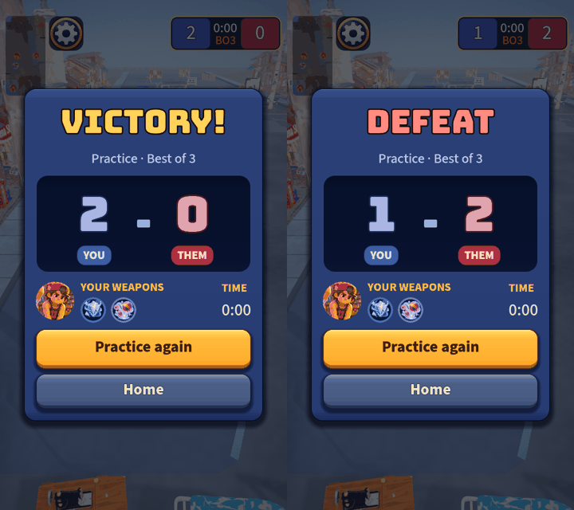

# UI rebuild, round 6: the match results card

Part of the UI rebuild ([critique and rounds 1 to 5](2026-10-20-ui-rebuild-critique.md)).

**Why this screen next.** I rendered the match end and the pause menu. The pause menu already wears the skin. The
match end was a "VICTORY!" banner floating over the live street and one "Play again" button: the one screen
every match ends on, with no score, no sense of what you just did and, in practice, no way home but the pause
menu. It is also an overlay, so it can be rebuilt without touching the thumb controls or the sim (the other
HUD pieces need a phone to judge).

**What it is.** The street's own banner shows first for a beat (1 s), then a card eases in over a dimmed
street: the big result, the mode and best-of, the final score (yours on the left in blue, theirs in red), your
kid's face and the two weapons you carried, the match time, one gold action (*Practice again*, or *Return home*
online) and, in practice, a quieter *Home*. It reads the sim only; the old button is the same button moved into
the card, so every caller and test that knew it still works.

Self-critique:

- **A hidden dependency.** Moving the existing button into the card re-adds it to the tree, which made the
  `Settings` autoload wire its click sound twice and log an engine error. The fix is the same one-line guard as
  in the weapons PR, applied here too (identical text, so the two merge cleanly in either order).
- **First draft was flat.** The score numbers were washed-out pastels and the time was an unlabeled "0:00".
  The numbers are brighter with a team-coloured outline, and the time sits under a "TIME" label.
- **Not yet in it:** no per-player stats (tags, rescues, damage), because the sim does not track them and the
  design has no stats by intent; a match summary is only what the sim already knows. Adding stats is a sim change
  (and a design call), not a UI one.
- **Not checked on a phone:** the card is 600 design px wide inside the 720 px width, with safe-area insets handled
  by the HUD; the pop-in tween is the only animation (off with Reduce motion).
