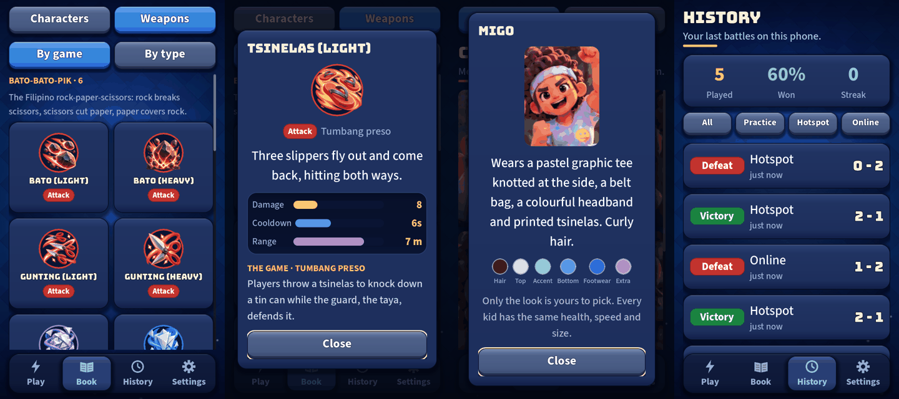

# UI round 10: the Book with depth

Round 10 of [the UI roadmap](2026-10-20-ui-roadmap.md): weapons by game with the real game behind them, stat bars, a
kid's outfit as a palette, and a History that summarises.

## What shipped

- **The game behind each weapon.** One plain sentence for each of the five street games (Bato-bato-pik, Jackstone,
  Langit Lupa, Tumbang preso, Trumpo), kept as data (`data/rules/street_games.tres`, class `StreetGames`). It shows
  under each section header in the By game view and as *The game* on a weapon's sheet. Text only: it never touches
  play.
- **Bars, not just numbers.** A weapon's damage (or healing), cooldown and range are bars on its sheet, each as
  full as the number is next to every other weapon's (a full bar is the biggest in the game), with the exact number
  beside it. Gold for damage, green for healing, blue for cooldown, purple for range. A stat a weapon does not have
  has no bar.
- **Outfit palette on each kid.** Swatches of hair, top, accent, bottom (only if they wear one), footwear and extra
  (only if they have one), read from `CharacterDef`. **Skin tone is deliberately not a swatch:** the palette is about
  clothes and style, as the design asks.
- **History with numbers.** Played, Won (a whole percent) and Streak (wins in a row since the newest) above the list,
  and a filter: All, Practice, Hotspot, Online. The numbers follow the filter. With no battles at all the figures and
  filter stay hidden and the friendly empty card shows.

## Self-critique

- **The sentences are mine, from common knowledge of the games.** Street games vary by region and family; the
  Jackstone and Langit Lupa lines in particular are general on purpose. They are data, one line each, so correcting one
  is a one-line edit. I would rather you correct them than that I pretend they are authoritative.
- **A bar is relative, so it is a comparison, not a rating.** A short damage bar means "less than the strongest weapon",
  not "weak"; a weapon with a short cooldown has a short bar, which is better. Cooldown is the one bar where shorter is
  good. The caption and the exact number carry that; a "lower is better" hint would add clutter, so I left it.
- **The four History filters needed a smaller label** (they overflowed at the standard size and would have widened the
  page). `UiSegmented` got a font-size option, and a test checks they fit.
- **Not done:** the Book's two tabs still switch without a slide, the Filipino version of the sentences (you did not
  say you wanted it), and any weapon art change.
- **The GDD's Book line is not edited here.** Round 9 rewrote the same long line and two PRs editing it would
  conflict; I will update the line after that merges.

## For the owner

Open Book, Weapons, By game: read the sentence under each game and correct any that is wrong. Tap a weapon: bars and
*The game*. Tap a kid: the palette. Then History after a few matches.
