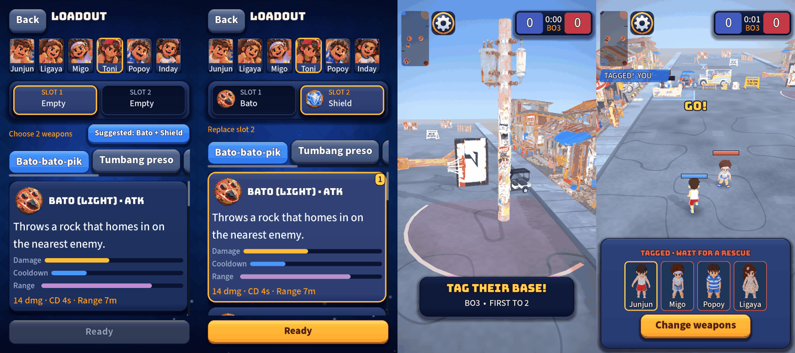

# UI round 11: one look from the menu to the match

Round 11 of [the UI roadmap](2026-10-20-ui-roadmap.md). Closes gap 6 (chrome from two eras) and adds the loadout
comparison.

Loadout with a suggestion, after taking it, the opening card and scoreboard, and the tagged sheet:

## What shipped

- **The old flat cards now wear the skin.** The scoreboard frame, the opening objective card, the tagged sheet and
  the status pills (the HUD's `HudPill` look, now `UiSkin.pill`) are the same night and raised panels as every menu.
  Nothing moved: sizes, anchors and touch controls are exactly as before.
- **Bars on the loadout cards.** Each weapon card has three compact bars (damage or healing, cooldown, range), scaled
  against every weapon as on the Book's sheet. The amber line under them stays, because it carries what a bar cannot:
  "per snip", "per bounce", "per tick".
- **A suggested pair.** For a player who has picked fewer than two weapons, a blue *Suggested* button beside the hint
  names a homing attack and a block (Bato + Shield today) and fills both slots on one tap. It sits in the hint's row,
  so the screen gains no height, and it is not offered when swapping weapons after a tag. `WeaponPick.suggestion` is a
  plain, tested function; anyone can still choose any two.
- **A bigger countdown ring** (72 to 104 px) that pulses red in its last three seconds (steady with Reduce motion).

## Self-critique

- **The capture line is not a pill.** I planned to put it on the skin too, but the big "HOLD THE BASE!" text is
  deliberately plain outlined text over the street; a panel behind it would cover the play area. I left it, and the
  feed lines (the skewed blue and red TAGGED! strips) stay as they are: they read as game, not as menu.
- **The bar helpers were reused, not copied.** Round 10's bar row became public and got a compact mode instead of a
  second implementation. The bars in the cards are made touch-transparent: a ProgressBar swallows taps by default,
  which would have made the middle of every card dead. A test checks every bar control.
- **The suggestion is an opinion.** "A homing attack plus a block" is the gentlest start I could justify from the
  data (the homing throw aims itself; the shield needs no aim), but it is a design choice, not a rule. It is one
  small function and easy to change or drop.
- **The skin radii are not on the boot warm list yet.** Round 9's warm list lives in a different pull request; the
  night radii 18 and 30 and the pill's 20 will cost a few milliseconds the first time a match opens. I will add them
  once both are merged.
- **Not checked on a phone:** how the dark scoreboard and cards read against the brightest part of the street, and
  whether the suggestion button is large enough beside the hint on a narrow phone.

## For the owner

Start Practice with no saved loadout (or tap both weapons off): the blue *Suggested* button should be next to
"Choose 2 weapons". Tap it. Then play: the score card, the opening card, and (when tagged) the tagged sheet should match
the menus.
