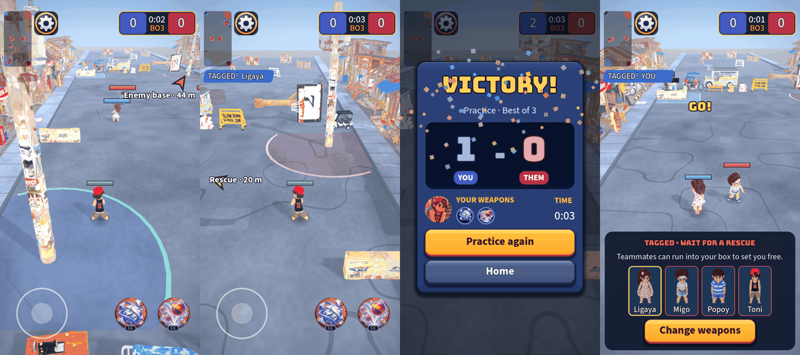

# UI round 12: show the player where to go

Round 12 of [the UI roadmap](2026-10-20-ui-roadmap.md), the last planned round. Closes gap 5 (the match gives no
direction).

The enemy-base arrow, the rescue arrow (the box is off the left edge), the results card counting up with confetti, and
the tagged sheet with its hint:

## What shipped

- **Direction arrows** (`DirectionArrows`). While the match is played and you are free, a soft arrow on the screen edge
  points toward the **enemy base** ("Enemy base · 44 m"). While a teammate is tagged in your box, a second, gold arrow
  points toward the box ("Rescue · 20 m"). They are drawn from the sim and the camera, stay inside a margin that
  keeps them off the minimap, the score and the controls, fade out when the target is on screen, never take a touch,
  and hide while you are tagged (the tagged sheet takes over). The pulse stops with Reduce motion.
- **A results moment.** The two scores count up from zero and a win throws a short burst of confetti in four colours.
  A loss gets neither the confetti nor any extra fuss, and Reduce motion shows the final numbers at once.
- **A hint for the tagged:** one line under the title, "Teammates can run into your box to set you free."

## Self-critique

- **Rematch is not done, and I should have said so earlier.** The plan listed *Rematch* online. A rematch needs the
  server to reset a room and keep its members, which is a protocol and server change (not UI), so I did not fake a
  button that cannot work. Online still ends at "Return home". If you want it, it is a networking round of its own.
- **The rescue arrow fades when the box is on screen.** That is the plan, but with this camera the far end of the
  street is often on screen, so the rescue arrow mostly appears once you are near the other end. It may be worth
  keeping a smaller marker on the box itself; I would decide that after you try it on a phone.
- **The arrows are the part I cannot judge without a phone.** Whether they help or crowd the street, whether the
  margin clears the minimap and thumbs on every notch shape, and whether the labels are readable over the bright road
  are real-device questions. The tests pin the maths (edge point, the margin, the fade, what is targeted), not the feel.
- **The first tagged hint wrapped to two lines** with a lonely word on the second; I shortened it and the test now
  checks it is one line.
- **Confetti is a switch in code, not data** (`MatchResults.CONFETTI`). The plan said "one switch in the data"; the
  constant is the smallest honest version of that, and the owner has not yet said how loud a win should be.

## For the owner

Play a practice match: walk toward the enemy base and watch the arrow; get an ally tagged and look for the gold arrow;
win a match and watch the numbers and the confetti. Tell me if the arrows crowd the street.
