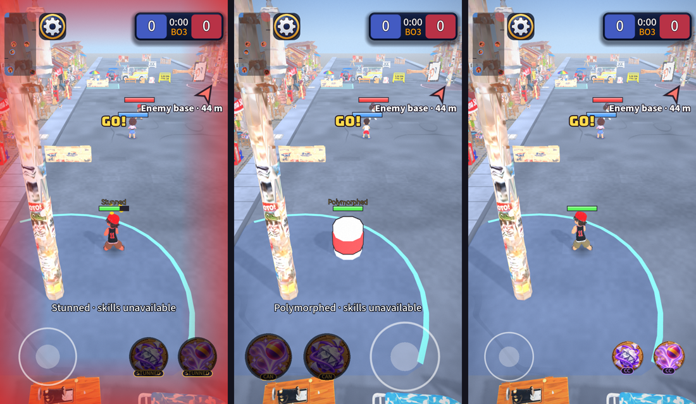

# UI round 13: how a match feels

First of the in-match rounds that came out of "what should the interface do next during gameplay". Everything here
is about what the player feels while playing, not what a menu looks like.

Left: hit and stunned (red edge glow; both weapon buttons dimmed and tagged STUNNED). Middle: **left-handed, large
controls**, polymorphed (tag CAN). Right: **small controls**.

## What shipped

- **A glow when you are hit** (`HurtPulse`). The screen edge glows red for 0.4 s, harder for a bigger share of your
  health, and for 0.9 s with a longer buzz when you are tagged. A lighter hit never cuts a stronger glow short; your
  allies being hit never glows; the buzz is spaced 0.25 s apart so a burning field does not buzz without end (a tag
  always buzzes). Reduce motion: half as strong and shorter.
- **A weapon button swells when it is ready** (`TouchButton`): it grows 14% and a bright wash fades over it, on top of
  the ring flash that was already there. Not with Reduce motion.
- **A blocked button says why.** While a status stops you casting both buttons dim deeper and the tag under the art
  turns amber and names the cause: STUNNED, AIRBORNE, BOUNCED, DOWN, CAN (polymorphed into the can). A slow is not
  a block, so it shows nothing.
- **Controls that fit your hands.** Settings (and the in-match settings) has **Left-handed** and **Control size**
  (Small 85%, Normal, Large 120%). Left-handed puts the stick on the right and the weapons on the left, the cancel
  zone with them. Size scales the weapon buttons and the stick (its rings and its grab area grow together). Both
  apply to a live match at once.

## Self-critique

- **Left-handed reverses an earlier owner decision.** The GDD said "no handedness setting" and a test enforced it.
  I proposed it in the round-13 plan and you said go ahead, so it is in, off by default, and that test now checks
  "right-handed is the default". If you meant the plan's feedback items only, delete the `ControlOptions` row in
  `settings_page.gd` and the layout falls back to the old one; nothing else depends on it.
- **I said the ready cue was missing. It was not:** a ring flash on cooldown end already existed. What I added is a
  bigger swell and a wash. Whether that is enough to notice with a thumb on the button, I cannot tell from here.
- **The camera shake on a hit already existed** (and still does). The glow adds the corner of the eye, not a
  replacement.
- **The buzz is not testable here.** The phone only buzzes in a native Android or iOS build, never in the web build, so
  the iPhone browser shows the glow but never the buzz. I tested the rule (spacing, tag always buzzes), not the feel. The
  Vibration setting's text now says it also buzzes when you are hit.
- **The large stick's grab area is bigger than the normal one** (it scales with the rings). A thumb that rests where the
  old stick ended will now be inside it. That is the point, but check it does not catch a thumb meant for the weapons: the
  buttons clear the larger outer ring by design (a test checks it).
- **Strength is a guess.** The peaks and times are constants at the top of `HurtPulse` (and `READY_POP`/`READY_WASH` in
  `TouchButton`). Too much? Too little? That is a one-line change.

## Not done (round 14, on purpose)

Low-health warning, an objective bar, a marker on the box, a minimap pulse, and pings.
