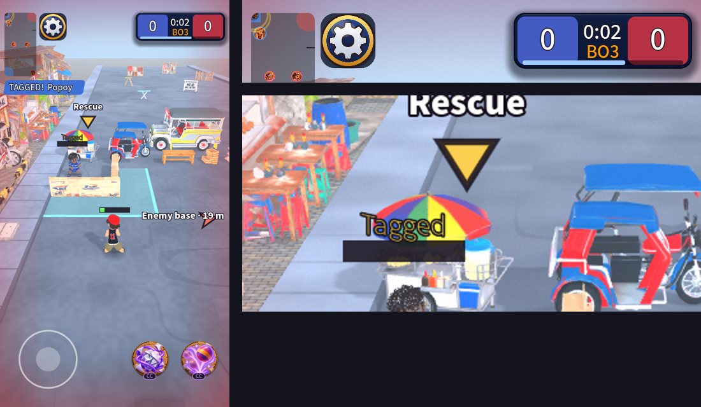

# UI round 14: awareness

Second of the in-match rounds (after [round 13](2026-10-20-ui-round13.md), which this stacks on): knowing what is going
on without looking for it.

Low health breath on the edge, the capture bar inside the score card, the rescue marker over the box and a ring on the
minimap where a teammate was sent:

## What shipped

- **Low-health breath.** Below 30% of your health the screen edge stays on as a slow red breath (1.6 s a cycle)
  until you are healed or tagged. A hit or tag glow shows over it (the stronger of the two wins). Reduce motion: a
  steady faint edge.
- **A capture bar on the score card.** While a team holds the other base (or the other team is all tagged) a thin
  bar along the card's lower edge fills over the capture time: light blue when it is yours, light red when theirs.
  It is *inside* the card, because the GDD says nothing sits under it.
- **A rescue marker.** When a teammate is tagged and the box is on screen, the gold Rescue arrow gives way to a
  bobbing gold marker above the box. Off screen it is still the arrow.
- **Minimap rings.** A gold ring where a **teammate** was sent to the box; a ring in the scoring team's colour round
  the base that was captured. They grow and fade over 1 s (only fade with Reduce motion). An enemy being tagged is
  **not** pinged: that would tell you where they are.
- **Two leftovers.** The GDD's Book and History lines now say what rounds 9 and 10 built, and the in-match score
  card's plate is on the skin's warm list (a new test opens a match, a tag, the menu and the results card and fails
  if any texture is drawn that loading did not build).

## Self-critique

- **The capture bar duplicates the big text in the middle** ("HOLD THE BASE! 3"). That is deliberate: the text
  is what you read, the bar is what you glance at while looking at the top of the screen. If it turns out to be too
  much, the middle text is the one to keep.
- **The bar runs along the bottom of both score boxes**, so it crosses the red box even when it is your capture. I
  made it a lighter tint so it reads against both, but a slimmer card with a gap would be cleaner and I did not want
  to change the card's size without asking.
- **The rescue marker sits high above the box** (150 px) to stay clear of the kid's own status text, which makes it
  look like it floats over the street. It points down at the box; I would not shrink it further.
- **The ring on tag is at the box, not where the kid was tagged.** The sim moves a tagged kid to the box before
  it says so, so the ring says "someone was sent to the box", not "someone was hit there". That is right for a
  rescue and useless for "who is attacking me".
- **I cannot judge any of the strengths from here** (breath 0.1 to 0.28, ring 1.6 px wide on a 100 px map). Each is
  a constant.

## Not done

Pings between players, anything online-specific, and an on-screen marker for where a teammate was tagged.
