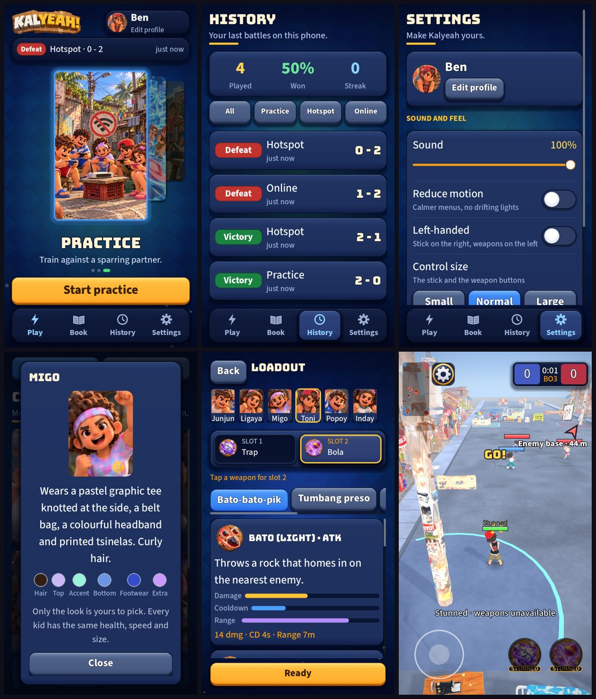

# UI round 15: words and floors

Round 15 of [the UI plan in audit 4](2026-10-20-ui-audit-4.md). Stacked on the practice-bot work.

After: Home (Practice), History, Settings, a kid's sheet, the loadout and the match with both weapons stunned.

## What shipped

- **Copy.** The boot tips no longer say "two skills" or "dash". Practice says "Train against a sparring partner."
  The page is called **Room**, like the buttons that open it. The format is said once as "Best of 3" (the room's status
  line is just "Ready to play"; the opening card says "BEST OF 3"; How to play still explains "first to 2 points").
  "Replace slot 2" is "Tap a weapon for slot 2". "Practice tools +" is "Show practice tools" / "Hide practice tools".
  "Can't reach that address." is "Can't reach the server. Check your connection and try again." One ellipsis (…) and one
  separator (·) everywhere. The match hint says "weapons unavailable", not "skills".
- **A name as typed.** The Settings name was in the display font, which is all capitals, so "Ben" read "BEN". It uses the body
  font now, like Home and the profile sheet.
- **Floors.** Text under 22 px is gone: the weapon type tag on the buttons (15 to 20), the status over a kid (19 to 22), the
  weapon-type chips (20 to 22), the palette labels (18 to 22), a card heading (19 to 22) and the gallery's notes (20 to 22).
  Targets under 80 px are gone: History's filters (64 to 88) and the last-match strip (64 to 88), and the gallery's buttons.
- **Focus ring only after a key.** A dialog opened by a finger no longer puts a gold ring on Cancel. A text field is still
  focused (typing needs it), and the first Tab or arrow key brings the ring; once a key or gamepad was used, dialogs open
  with it until the next touch or click (`Settings.keyboard_active`).
- **A lint test** (`test_ui_lint.gd`, 10 tests) that opens 40 or so screens and states and fails on text under the floor, a
  target under the floor or a banned word, plus a scan of every string in `scripts/ui` and `scripts/view` for three dots
  and a bullet. This is the part that keeps it fixed.

## Self-critique

- **The type floor is 22, not the 24 the scale calls its smallest step.** 24 would have forced the chips and tags into
  layouts that do not fit. 22 is 11 pt on a 360 pt phone, which is the smallest size Apple's guide allows. The 20 px weapon type tag on
  the buttons is the one deliberate exception, a micro label on a 124 px disc, and has its own test.
- **The weapon tag can be wider than its button.** "STUNNED" and "AIRBORNE" at 20 px are a little wider than the 124 px
  disc (see the match shot). It reads and nothing covers it, but it is not tidy.
- **The lint cannot see text that is drawn, not a Label** (the tag and the status over a kid are checked by their constants).
- **"Room" replaced "Lobby" everywhere on screen**, but the server and the code still say "lobby". Only players read
  the screens.
- **I did not touch the weapon names or "CC".** Those are your decisions in audit 4.

## Next

Round 16, the loadout.
