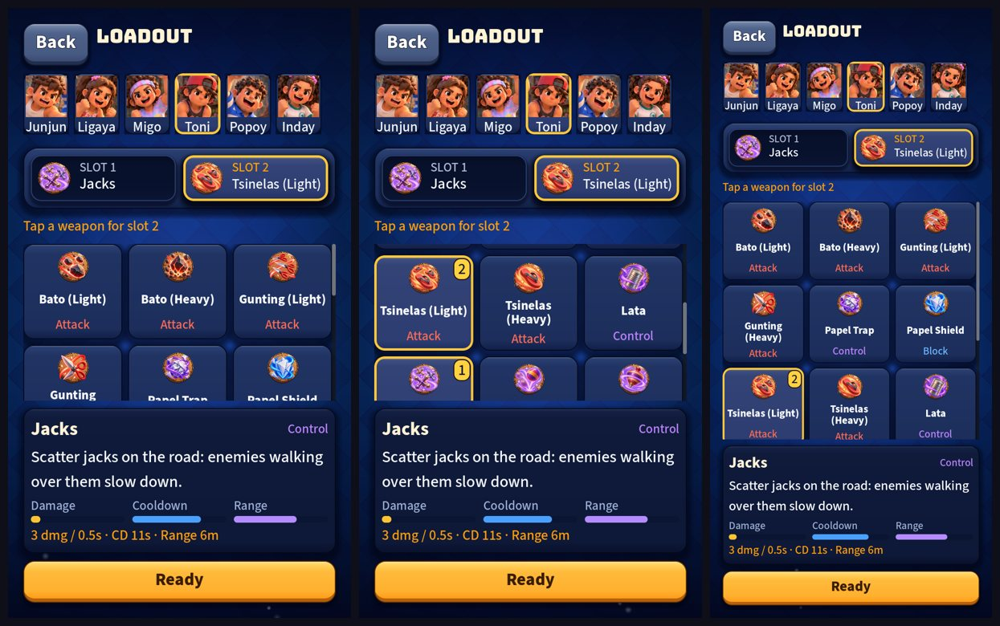

# UI round 16: the loadout

Round 16 of [the plan in audit 4](2026-10-20-ui-audit-4.md) (finding F1, the weakest screen). Stacked on round 15.

Left: a short phone (720x1280), at the top of the grid. Middle: the same, scrolled. Right: a tall phone (720x1558).

## What shipped

- **A grid, not a list.** The weapons are tiles three across (painted art, name, kind; a gold border and a 1 or 2 once
  picked) in one scrolling grid, instead of one tall card each behind street-game tabs. Before, a short phone showed
  about one card and you scrolled to compare; now it shows about four tiles at once, and a tall phone eight. The tabs
  are gone (the street game is in the Book; here the tile's kind says what it does).
- **One info panel.** Touch a tile and it is picked and its words appear once, under the grid: name, kind, description,
  three short meters (Damage or Heal, Cooldown, Range, scaled like the Book's) and the exact numbers line. The old card
  printed the bars *and* the numbers *and* the description on every weapon; now they are said once, for the weapon you are
  looking at.
- **The same name everywhere.** A slot used a short name ("Trap") and a card another ("Papel Trap"); both say what the
  tile says now (the size steps down, never below 22 px, to fit).
- **The two slots, the hint, "Suggested" and Ready stay put**; the swap screen while tagged is the same grid.
- Tests: 5 new in `test_ui_round16.gd`; the old tab and card tests in three files were rewritten for the grid.

## Self-critique

- **A short phone (720x1280) shows a row and a half**, not two. Above the grid sit the header, the kid row, the slots and
  the hint; below it the panel and Ready. That is about four tiles before you scroll, which is three times the old
  number but not the "six at once" I hoped for. A 19.5:9 phone shows eight. Getting two full rows on a short phone would
  mean taking the kid row out of this screen or shrinking the panel, and I did not want to do either without asking.
- **A tile can be picked and shown in one touch, but not just shown.** There is no "look without picking". Touching a
  picked weapon unpicks it (as before). If you want a long-press that only shows, say so.
- **The meters are one row of three**, so a weapon with no range (a shield) has two. They are short; they are for
  comparing, and the line under them has the numbers.
- **Names are still the old ones** ("Tsinelas (Heavy)" wraps to two lines on a tile). The naming scheme is audit 4's
  decision 1; this round does not guess it.
- **Online has not been tried** (no server). The 10 s countdown ring is where it was, in the header; its test and the pick
  logic are unchanged.

## Next

Round 17, the match at a glance (the minimap and the small tags).
