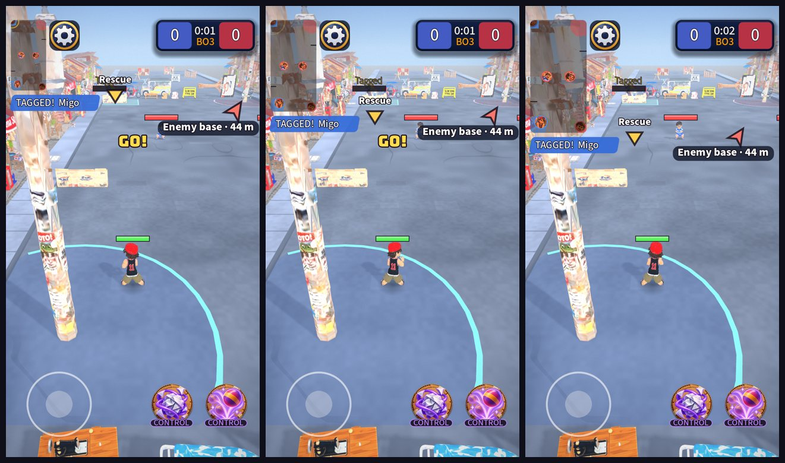

# UI round 17: the match at a glance

Round 17 of [the plan in audit 4](2026-10-20-ui-audit-4.md) (findings F3 and F4). Stacked on round 16.

The same match at the three minimap sizes: small (the old 100 x 200), normal (130 x 260, the new default) and large
(160 x 320). A tagged ally shows the gold Rescue marker.

## What shipped

- **A minimap you can read.** 130 x 260 px by default instead of 100 x 200 (about 54 pt on a 390 pt phone, now about 70),
  with a **Minimap size** choice in Settings (Small, Normal, Large) next to Left-handed and Control size, also in the match
  menu, applied at once. Faces are a little bigger (9 px instead of 8, at the base size) and the faces, their rings and the
  pings scale with the map. The gear, the feed and the direction arrows all move to stay clear of it.
- **Words on the weapon buttons.** "ATK", "CC" and "BLK" are Attack, Control, Block and Heal, the same words the Book uses, in
  capitals under the button's art. The longest ("CONTROL") fits the 124 px button (a test says so).
- **A label you can read.** The "Enemy base · 44 m" and "Rescue" labels sit on a dark pill, so they read over the street
  and over a kid's health bar they happen to cross.
- Tests: 11 new in `test_ui_round17.gd`.

## Self-critique

- **I did not make the minimap more opaque.** The GDD says (owner) it is light, see-through at 55% and unframed. The audit
  called it low-contrast; the size is the lever I could pull without changing your look. If it still reads poorly on a
  phone, opacity is one constant (`LaneMinimap.ROAD`) and your call.
- **The large map covers a good part of the top-left of the street** (160 x 320 px). It is a choice, not the default.
- **The label pill can still sit over a kid's bar**; it is readable now, but not out of the way. Moving it off the kids
  would mean knowing where every kid is on screen, which is more than a label is worth.
- **Not on a phone.** Whether 130 px is right is a thing to look at in your hand; the setting exists so it can be one tap away.

## Next

Round 18, depth: the weapon naming scheme (your decision), the gallery behind a developer switch, screen-reader names,
`tr()` on every string.
