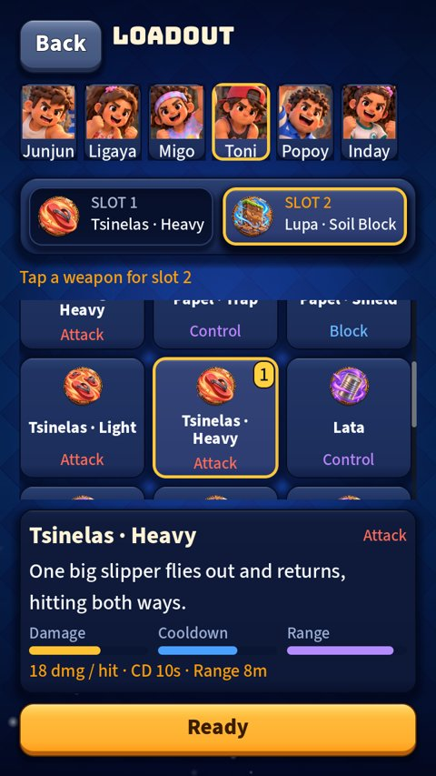

# UI round 18: depth

Last round of [the plan in audit 4](2026-10-20-ui-audit-4.md) (findings F2, F7 and F8). Stacked on round 17. It uses the defaults
I proposed for the decisions you had not answered yet; each is one line to change.

The loadout with the new names ("Tsinelas · Heavy", "Lupa · Soil Block") on tiles, slots and the panel.

## What shipped

- **One naming scheme.** "Name" or "Name · Role": Bato · Light, Bato · Heavy, Gunting · Light/Heavy, Tsinelas · Light/Heavy,
  Papel · Trap, Papel · Shield, Langit · Heal, Lupa · Soil Block, and Bola, Jacks, Lata, Trumpo as they were. No brackets. The
  short names (used where there is no room) are all different now ("Bato Light", not "Bato H"). (Audit decision 1: I took
  the scheme I suggested. "CC" was already changed to "Control" in round 17.)
- **Developer tools a player cannot stumble on.** The UI gallery button is hidden. Seven quick taps on the Settings title switch it
  on (and seven more off), with a message; on the web, opening the game with `?dev=1` turns it on for that visit. (Audit
  decision 4: hidden, not kept as a "Look" page.)
- **Names for a screen reader.** Every control with no words of its own now has an `accessibility_name`: the gear, the stick, the
  weapon buttons (with "Ready in 5 seconds" or "Hold and drag to aim"), the minimap, the score, the mode carousel, the profile chip, the
  tabs, every kid and weapon tile, the slots, the open slots, the room settings, the code field, the switches and the slider
  (named after their row's title). `UiA11y` is the helper, and **the lint test now fails on a visible button with no text and no name**,
  on a slider or a field with none, and on a drawn control (a weapon button, the stick, the carousel) with none. It found about 60 controls.
- **The structure for a second language.** All 267 words a player reads are in `data/i18n/strings.csv`, built by
  `tools/i18n/extract.py` (it keeps any translation already written and can check that the file is up to date). Godot translates a
  Label's and a Button's text by itself when it is a key; drawn text (the weapon tag, the word over a kid, an arrow's label, the
  "BO3") goes through `UiText`. A **Language** choice appears in Settings only when a second language has at least 30
  translated messages, so a half-finished file is never shown. `tools/i18n/README.md` says how to add Filipino in four steps.
- Tests: 18 new in `test_ui_round18.gd`; the lint grew three rules; the round 7 gallery test sets the developer switch.

## Self-critique

- **No Filipino is written.** I did not translate anything: the words are yours to write or approve, and I would rather ship no
  language than a wrong one. Until a column exists the game is exactly as it was.
- **Formatted sentences are mostly not translatable yet.** "Best of 3", "Back in 8" and the like are built with `%` in code. Godot
  cannot translate a built string, so each needs rewriting as `UiText.f("Best of %d", [3])` (the "BO%d" on the score card is done).
  The CSV lists them with their `%`, and the README says so. About 25 of the 267 are like that.
- **The extractor is a heuristic.** It finds the words by the calls that set them (a label, a button, a banner, a status), so
  a new kind of call can be missed; `--check` only compares with what it finds. A real list would come from marking
  every string in the code with `tr()`, which is a much bigger change.
- **The names were never read by a real screen reader.** I set and tested the properties; whether TalkBack or VoiceOver read them well
  on a web build or an APK is for a phone to say.
- **Seven taps is hidden, not secure.** It keeps players from meeting developer tools; it is not protection.

## Done

That is the plan of audit 4: rounds 15 to 18. What it did not cover is on the audit's last list (a phone in the hand, transitions,
online with a server).
