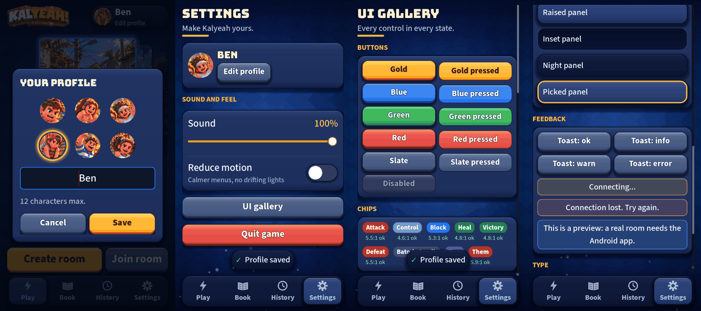

# UI round 7: feedback, profile and the UI gallery

Round 7 of [the UI roadmap](2026-10-20-ui-roadmap.md). Closes gaps 2 and 3 (the screen never answers back; you
cannot pick your face) and adds the gallery that later rounds build on.

## What shipped

- **Toast** (`UiToast`): a short pill above the tab bar for ok, info, warn and error, one at a time, on its own
  canvas layer, never taking a touch. First uses: "Profile saved", and "Room code copied" (copying the code was
  silent before).
- **Status strip** (`UiStatusStrip`): the lobby's status line is now dressed by what it says, amber while waiting
  ("Connecting..."), red for a problem ("Connection lost. Try again."), blue for a note. The words and when they show
  are unchanged, so every existing test on them still holds.
- **Profile sheet** (`ProfileSheet`): your name and your face (the six kids in round toggles, a gold ring on the
  chosen one). Save keeps both; Cancel and an empty name keep neither. Opened from the chip on Home and from
  Settings (now "Edit profile").
- **UI gallery** (`UiGallery`): Settings, UI gallery. Buttons (resting, pressed look, disabled), chips with their
  measured contrast, switch, segmented control, field and slider, the five panel kinds, toasts and strips, the
  type scale and the faces.
- **Chip contrast fixed** (it was planned for round 9; the gallery made it impossible to leave): the Heal chip was
  2.41:1. All chip fills are now at least 4.5:1 with white text (`UiKit.CHIP_*`), pinned by a test.

## Self-critique

- **A bug I found by looking at the screen, not by a test.** After renaming yourself the chip on Home kept the old
  name until the screen was rebuilt (nothing refreshed it). The profile sheet now refreshes the chip and the Settings
  card, and a test pins it.
- **The toast sits over the main buttons on Home.** Floating above the tab bar puts it on the lower edge of Create
  and Join for two seconds. It never takes a touch, so nothing is blocked, but it is not elegant; moving it would
  need Home's layout to reserve a strip, which I did not do for a two-second pill.
- **Message kind is read from the text.** `kind_of` looks at an ellipsis or a few words ("can't", "lost", "no room").
  It is a heuristic, kept in one place and tested on every status the lobby produces, but a new message in an
  unexpected wording would come out blue. The fix then is to pass the kind explicitly.
- **The gallery shows a "pressed" look rather than a pressed button.** A real pressed state needs a finger, so the
  pressed column is the pressed style on an inert button. The live column is the real thing.
- **The profile sheet is a dialog, not a bottom sheet.** Same dim, focus restore and Android Back as every other
  modal, at the cost of a less native feel.

## For the owner

Open the gallery on your iPhone (Settings, UI gallery) and look for anything that reads wrong in one state: that is
what the page is for. Round 8 (first-run help and joining with code boxes) uses the toast and strip from here.
