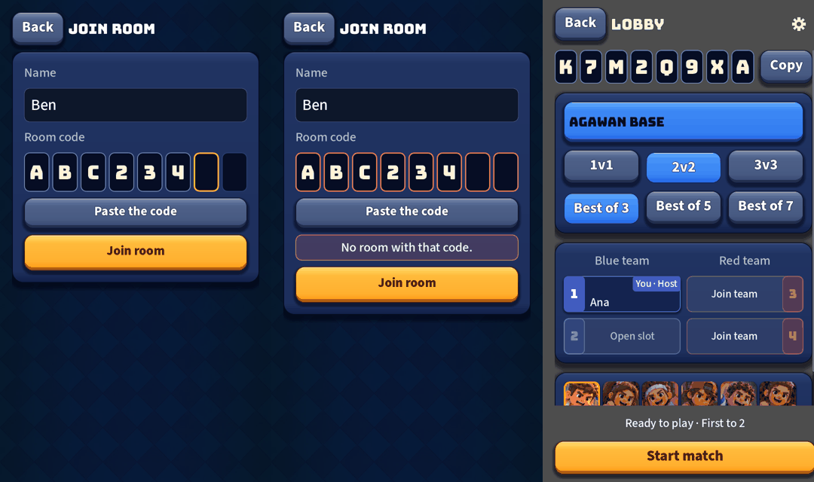
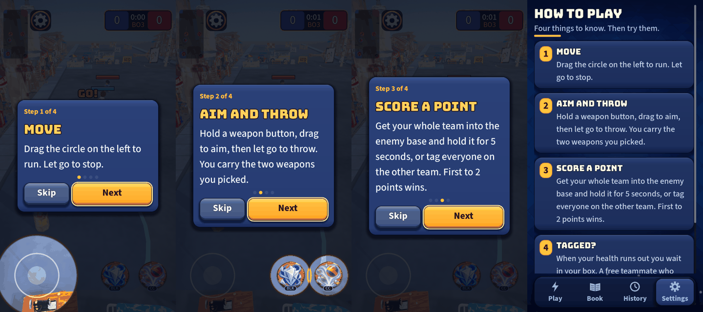

# UI round 8: the first minute

Round 8 of [the UI roadmap](2026-10-20-ui-roadmap.md). Closes gaps 1 (nobody is taught) and 4 (typing a code on a phone).

**Joining with the code boxes** (join with typing, a wrong code, and a room's code with Copy):

**The first-run walkthrough** (steps 1 to 3) and **How to play**:

## What shipped

- **Code boxes** (`UiCodeBoxes`): the code as eight boxes. A real LineEdit sits invisibly over them, so the phone
  keyboard, long-press paste and a tap anywhere work; the boxes show what it holds. Capitals only, anything outside
  the code alphabet (no I, L, O, 0, 1) is dropped, at most eight. The next box is lit gold; a wrong code turns them
  red until you edit it; a full code moves the focus to Join room.
- **Paste the code** button: fills the boxes from the clipboard and says what it did ("Code pasted", "Pasted 3 of 8
  characters", "Nothing to paste. Copy the room code first.").
- **Errors next to the boxes.** The server's own reason ("No room with that code.", "That match has already
  started.") now shows right under the boxes in a red strip, not at the bottom of the screen. The words are unchanged.
- **The room shows its code as boxes** with Copy and the "Room code copied" toast (the old plain label is kept, hidden,
  as the data the tests and the screen read).
- **First-run walkthrough** (`CoachMarks`): four steps (move, aim and throw, score a point, what tagged means). The
  joystick, then both weapon buttons, are lit through a dim with round holes (a small shader). The match's own
  controls are off while it shows. Next, Skip, and Android Back. Shown once, on the first practice match, and saved.
- **How to play** (Settings): the same four steps as cards, and a gold button that starts a practice match with the
  walkthrough again. The numbers (capture seconds, points to win) come from the rules data.

## Self-critique

- **Tests had to be told about the server address.** The join check ("Enter all 8 characters") sits behind an
  "Online isn't available yet" check, which is right for the game and tripped my first test. The test now sets a
  server address and restores it.
- **The first status line was in the wrong place.** My first screenshot of a refused join showed the reason at the
  bottom of the screen, far from the red boxes. It now sits under them.
- **The card moves between steps.** It is centred, so its height changes with the text and it shifts a little from
  step to step. Pinning it to the top edge would stop that but would hide more of the street; I chose the shift.
- **Online first-timers get no walkthrough.** It only opens in practice (online matches have no pause and a
  walkthrough over a live opponent would be unfair). The How to play page covers them.
- **The spotlight ring is drawn, the hole is a shader.** Two separate things; if they ever disagree by a pixel on
  some phone, the ring is the one to trust. Not checked on a phone.
- **Not done:** the native Android share sheet for the room code (the web build can only copy), and a coach for
  the join screen itself (the boxes and the Paste button are meant to explain themselves).

## For the owner

Play Practice with a fresh install (or Settings, How to play, Practice with the walkthrough) and tell me whether the
four steps read well and whether the lit circles sit exactly over the real controls on your phone. Round 9 (a Home
that fits every phone) is next.
