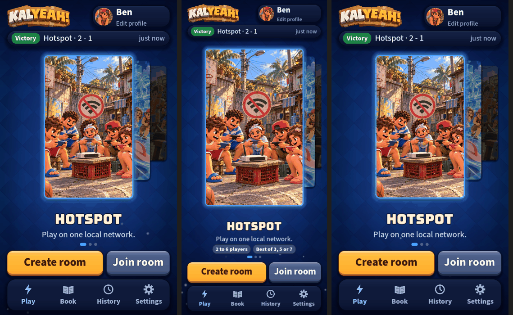

# UI round 9: a Home that fits every phone, and a faster skin

Round 9 of [the UI roadmap](2026-10-20-ui-roadmap.md) and findings 1, 2 and 7 of [the audit](2026-10-20-ui-next-audit.md).

16:9, 19.5:9 (the common phone) and a short 9:16 screen, each with a last battle recorded:

## What shipped

- **A skin that is faster and built ahead of time.** Every texture is the same left and right, so each is drawn
  as its left half and mirrored. The result is **pixel-identical** (checked by hashing 37 textures before and after)
  and about **2 to 3 times faster** (buttons 256 ms before, 83 to 143 ms after; panels 93 ms before, 38 to 61 ms
  after, repeated runs on a loaded desktop). The textures the first screens use (every button state, 12 panels) are
  now built one per frame behind the boot screen's loading bar, as 20% of the bar. A test fails if a first screen
  draws a texture that is not on that list; it caught one (`raised/34`) while I was writing it.
- **The hero grows with the screen.** It was a fixed 400x640. On a 19.5:9 phone it is now 488x780, filling the space
  that sat empty. Still 2.5:4; the chosen mode survives a resize.
- **Mode facts as chips.** "2 to 6 players" and "Best of 3, 5 or 7" come from the rules data; Practice says
  "Solo" and "Dummies don't fight back". They step aside when the screen is short, so the hero never shrinks for them.
- **A last-match strip** at the top of Play: result, mode, score and how long ago, from the history the phone
  already keeps. Hidden until there is a match. Tap it for History.
- **Pages slide in from the side their tab is on** (History from the right, the Book from the left) and **the tab
  plate glides** between tabs instead of jumping. Both stop with Reduce motion.
- **Idle motion rests under a cover.** The card's bob and the drifting lights stop while a page or a sheet is
  over Home and come back after.

## Self-critique

- **My first Home was a regression on the standard shape.** With the strip and the chips the hero shrank to 327 px
  wide on a 16:9 phone, from 400. The screenshots showed it; I made the chips step aside on a short stage and slimmed
  the strip. A returning player on a 16:9 phone still gets a hero 365 px wide (a first-time player with no history
  sees the old size), and the last-match strip is the reason; if you would rather keep the old size, the strip is the
  thing to drop.
- **The speed-up is 2 to 3 times, not the 4 times my plan said.** The plan assumed a quarter could be mirrored; only
  the left and right halves match (the shadow and gradient run down). I wrote down the number I measured.
- **The timings are noisy.** This machine runs other work, so a range is the honest figure. The loading-bar placement
  matters more than the factor: even at 2x, 30 textures cost about 150 ms on this desktop and several times that on a
  slow phone, now hidden behind the bar instead of the first tap. Not measured on a phone.
- **`raised/34` is a number to remember.** Any new corner radius has to be added to the warm list or the test fails.
  That is deliberate, but it is one more place to touch.
- **Not done from the plan:** the contrast fix (done in round 7) and the page slides in the Book's two tabs (they
  still switch without a slide).

## For the owner

Open Home on your iPhone: the card should fill the height, with chips under the phrase. Play a match, come back,
and the strip at the top should show the result. Tap through the tabs and watch the plate glide.
