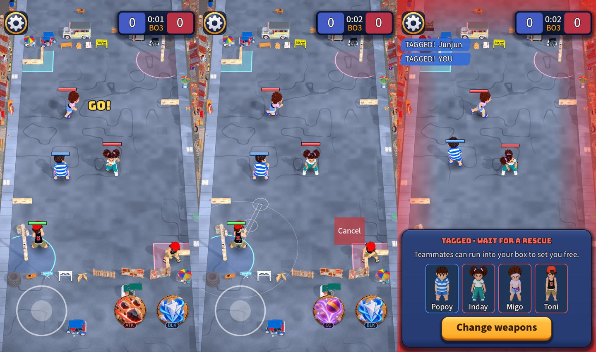

# Classic camera: the whole street on screen, like Clash Royale

Owner request: make the classic default camera exactly the camera of Clash Royale (or Archero 2), and re-arrange the map to match it and improve gameplay.
Decisions I asked for and got: copy **Clash Royale**, **reshape the map only** (keep the posts, boxes and cover walls), and **remove the follow camera** (only the Classic camera exists).

## "Exactly the same" is not possible, and what I did instead

Neither game publishes its camera numbers (I searched: nothing from Supercell or Habby, only guesses in forums that the Clash Royale view is close to orthographic).
So this copies what you can *see* of Clash Royale, which is what makes it feel the way it does:

- **One fixed camera that never moves. The whole arena is always on screen** (18 x 32 tiles, exactly 9:16, so it fills a portrait phone). Nothing is off screen, so nothing needs
  a minimap, an arrow or an edge tick.
- **A steep angle and a narrow lens**, so the picture is nearly flat: the far end is only a little smaller than the near end.
- **Chunky units** drawn much larger than their share of the arena, so they stay readable.
- **The HUD sits around the arena**, not over it: the top row above it, the controls below it.

## What changed

| | Before (follow camera) | Now (Classic) |
| --- | --- | --- |
| Camera | follows the kid, 14 m of street across the screen | **fixed**, the whole 27 x 48 m street on screen |
| Angle / lens | 44° / 60° (about 20 m away) | **50° / 20°** (about 160 m away, nearly flat; the far end is 83% as wide as the near end) |
| Street | 24 x 48 m (1:2) | **27 x 48 m (9:16)**, the shape of a portrait phone |
| Kids on screen | about 8% of the height | about 8% of the height, drawn **3.2x** their real size; the hit area is unchanged |
| Minimap, base arrows, threat ticks, aim peek, yaw lean | needed | **removed** (nothing is off screen) |
| Tagged view | the camera follows a teammate, tap a card to switch | the camera does not move; the cards only show who is there |

Left to right: during play, aiming (the line is the old 1 px one, see below), and tagged.

### How it fits any screen

`CameraRules.frame(aspect, arena)` solves two numbers from the screen's shape: the nearest distance at which the whole street fits (with 12% kept clear at the top for the score and
settings, 20% at the bottom for the stick and skills, 4% at each side), and the small shift that centres the street in the space left. A phone, a 3:4 tablet and a very tall
screen all show the whole street; the test checks five aspect ratios and that it is the nearest possible fit. The depth range is cut tight around the arena (the camera is far
away) so depth and the sun's shadows stay sharp; fog by distance was switched off because at 160 m it washed the whole street out.

### The map

Only the shape changed: 24 to 27 m wide, so the street is 9:16 like a phone, like Clash Royale's arena. Both posts, the boxes and the two cover walls keep their rules and their
place in the corners; the cover wall moved with the left curb and is still 11 m from the base centre. I did not add a river, bridges or lanes: that is a different game
(the other two options I offered). The simulation, the bots and the balance duels pass unchanged on the wider street.

## Things you should know

- **The kid is drawn 3.2x its real size.** That is how Clash Royale reads at this scale, and the ring under each kid and the weapon shapes stay the real size, but a kid now looks wider
  than the area its hit covers. It is one number (`kid_view_scale`).
- **The aim line is too thin for this camera.** On `main` it is a 1 px hairline. The thin ribbon line from the cast-feedback PRs (#208 to #210) is 0.07 m wide, which is only about
  1.6 px at this zoom: after those merge it should be about 0.18 m (`AimIndicator.LINE_WIDTH`). I did not touch it here because those PRs are not merged.
- **The home screen's map model** shows the far half of the street, now 27 x 24 m instead of an exact square; it re-frames itself, so it looks fine.
- **The minimap's face art** is still used on the profile, so only the minimap itself is gone.
- **Archero 2** (the other option) follows the player through rooms about one screen wide; that is the camera that was just replaced.
- Not tested on a phone.
