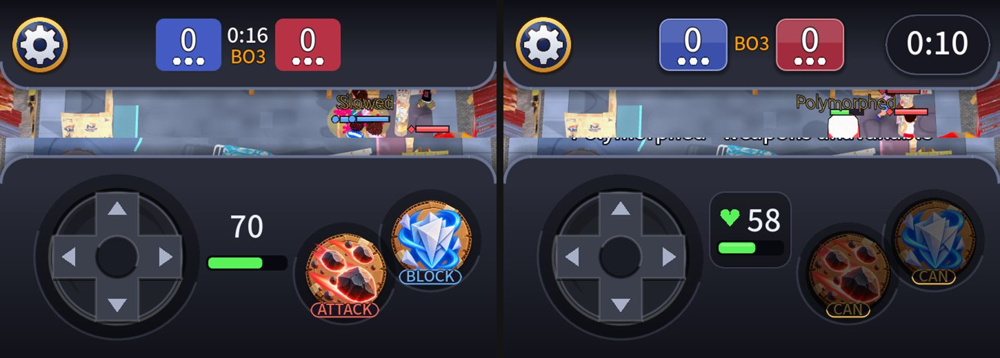

# Top and bottom of the gameplay screen

Owner: "improve GUI of top and bottom part of gameplay". A critique of a match screenshot (crops enlarged 2x) found:

**Top (header)**
- It was lopsided: the gear at the left, the score in the middle, nothing at the right; the clock was small and squeezed between the cells.
- The score cells were flat rectangles that did not match the deck's lit-edge style.
- Nothing said the round was in overtime, when captures get faster.

**Bottom (deck)**
- Health was a loose number over a thin dark bar floating in the gap between the pad and the buttons, with no icon, and the bar stayed one colour down to zero.

**What changed**
- The **match clock is a chip at the header's right** (`ClockChip`), level with the gear and the same height; in overtime (`MatchSim.in_overtime`) its edge turns amber and OVERTIME shows over the time.
- The **score cells** are keyed like the deck: the team colour with a lit edge, a soft sheen on the upper half and a shadow. The numbers are bigger (44) and the points to win (BO3) stand alone between the cells.
- **Health plate** in the deck's gap (`ConsolePanel`): a rounded inset plate with a heart and the number over the bar. The bar is your own colour from full to half, **amber below half, red below a quarter** (`ConsolePanel.health_color`, thresholds are constants).
- Not changed: the D-pad, the skill buttons (painted art, cooldown arc and ready pop), their wells, the deck and header shapes.

Colour-blind setting: your bar is pale yellow when healthy, so amber and red are told apart by the number and by the bar's length, as before.

