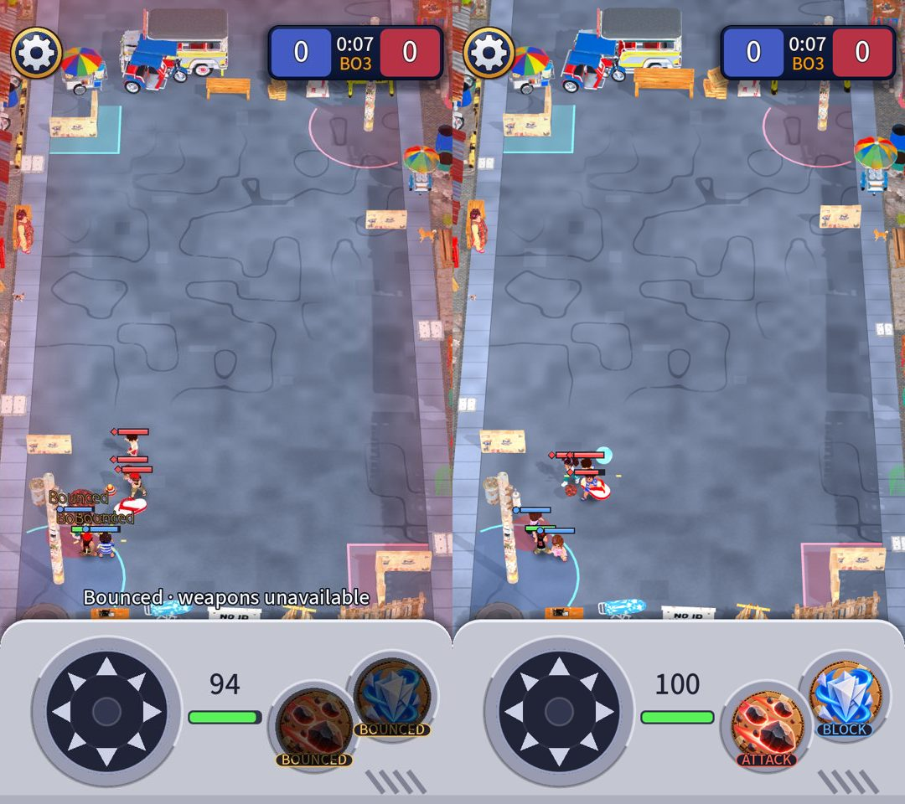

# Model scale audit: every model on one scale

Owner request: audit and carefully improve the scaling of all models. This follows [world scale](2026-10-21-world-scale.md), which fixed the kid to world
ratio; this one checks every single model against that scale and holds them there with a test.

## The scale, in one line
A real kid is 1.3 m; a kid is drawn 1.85 m x `kid_view_scale` 1.5 = 2.78 m. So the world is drawn **2.13x** real (`ScaleReference.world_factor`). Every prop
should be its real height times 2.13, give or take a chunky 30% (the toy look). `tools/art/scale_audit.tscn` prints the table; `tests/unit/test_model_scale.gd`
holds it. The real sizes are in `scripts/view/art/scale_reference.gd` (my estimates of everyday objects; change a line there if one is wrong).

## What I checked
| Check | Result |
| --- | --- |
| **Is a model's measured size true?** `PropModel.size_of` reads the first mesh of a GLB | All 34 props are exactly one mesh at the origin, each authored with its longest side at 1.0: the code tables are the single source of scale. A test now fails if a model ever gets a second mesh or an offset. |
| **Are the six kids the same height?** | Yes: 1.699 to 1.712 m in the model (under 1%), so one scale gives every kid the same height. Tested. |
| **Buildings** (houses, shops, the terminal) | Correct: each is a 4.8 m wide lot at true scale and 4.1 to 5.1 m tall (one to two storeys), about 3 to 4 kids tall. They were sized by width, so their heights differ a little; that is the owner's models and it reads right. |
| **Props, one by one** | 7 of 26 were outside the allowed band and 3 more sat at its edge; all 10 are corrected below. |
| **Thrown objects** | Drawn 0.84x to 2.0x the diameter of what they hit, all inside the 0.8 to 2.1 band the test allows. They are game-sized on purpose (a real top is 6 cm); left as they are. |

## What was off and what I changed (all constants in `street_map.gd`)
Ratio = drawn size over (real size x 2.13); 1.00 is exact.

| Prop | Before | After | Change |
| --- | --- | --- | --- |
| Bench | 0.71 | 0.97 | height 0.8 to 1.1 |
| Crates | 0.75 | 0.97 | 0.85 to 1.1 |
| School-zone sign | 0.56 | 1.00 | 1.7 to 3.0 |
| Roof wall, roof wall 2 | 0.73, 0.80 | 0.96 | 2.2 and 2.4 to 2.9 |
| Ice-cream cart | 0.80 | 0.95 | 2.1 to 2.5 |
| Cat | 1.43 | 0.96 | 0.45 to 0.30 |
| Dog | 1.19 | 0.99 | 0.75 to 0.62 |
| Drainage cover | 1.46 | 1.00 | width 1.1 to 0.75 |
| Cardboard cover wall | 0.59 (it never reached its height) | 0.75, exactly `cover_height` 2.4 m | `PropModel.fit(..., exact)` |

The cover wall was a bug, not a number: `PropModel.fit` took the smaller of the footprint's shape and `max_height`, so the 2.4 m we asked for drew at 1.9 m.
Cover now uses the exact height (in the match; the main-screen model keeps the true size).

Everything else was already inside 0.85 to 1.15. Two are deliberately off the general rule and listed in `ScaleReference.EXCEPTIONS`: the **electric post**
(11 m, 0.57x: a true-scale pole would hide a column of the street behind it) and the **cover wall** (a gameplay footprint, a height chosen to read as cover).

## Side effects
- The bigger roof walls and school sign take more room in the end-of-street rows (a row holds a few fewer things, the rest stand on the road beyond).
- Nothing about play changed: footprints, hitboxes, bases and rules are untouched.

## Rerun
`godot --headless res://tools/art/scale_audit.tscn` (the table), and the suite for the test.
