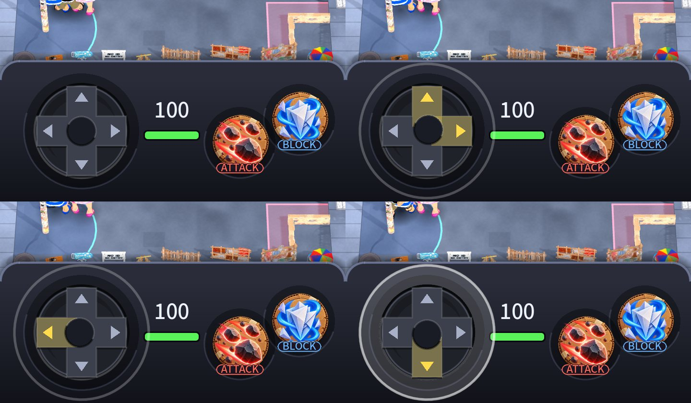
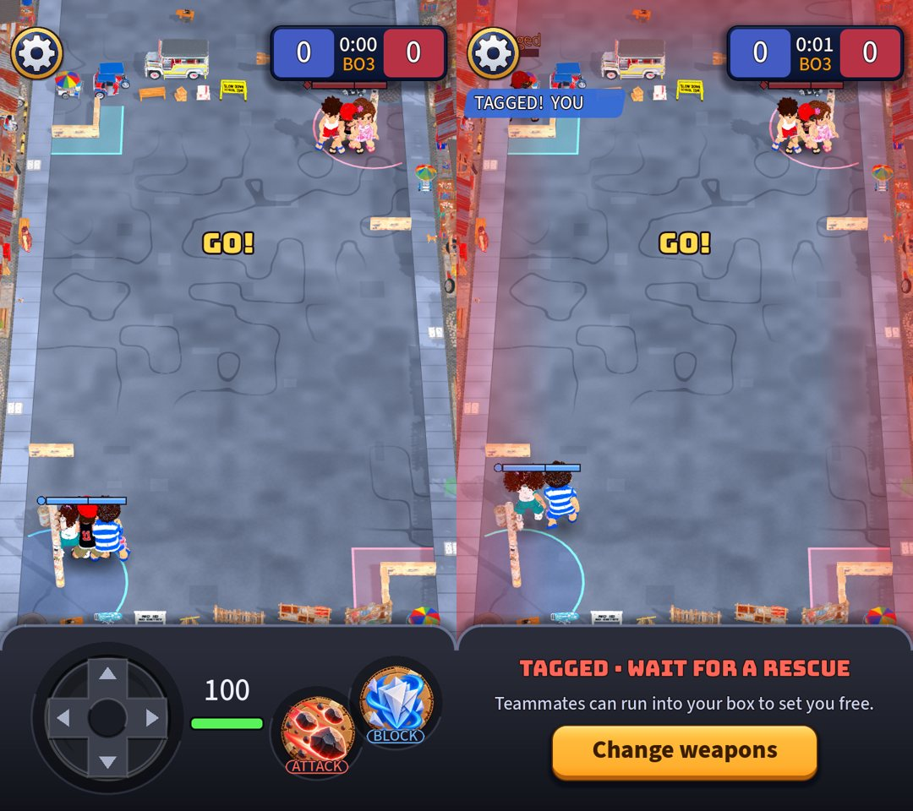
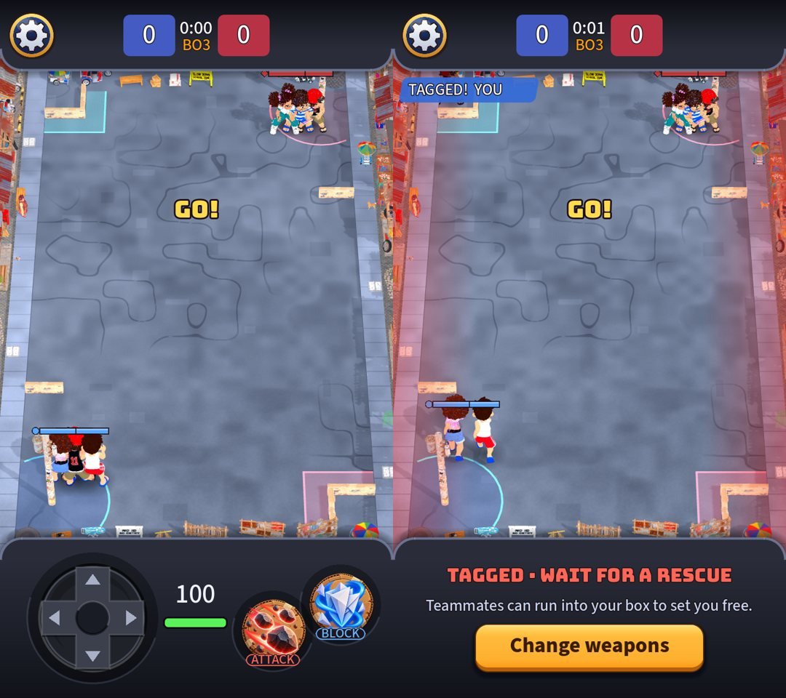

# A modern controller deck and an Xbox Series D-pad

Owner request: the bottom part should have a modern design rather than the old Game Boy style, and the D-pad should be the same as the Xbox Series one.
(Replaces the look of [the Game Boy console](2026-10-21-gameboy-console.md); the layout, the camera reserve and the safe area are unchanged.)

## What changed (`console_panel.gd`, `dpad.gd`)
- **The deck:** graphite instead of light grey: a dark body that fades toward the bottom edge, rounded top corners with a thin lit lip, a deep soft shadow above
  it, and quiet round wells under the controls instead of grey sockets. The four speaker grooves are gone. Your health number is white on it.
- **The D-pad:** drawn as the Xbox Series pad: a round dark dish (lit lower rim, shaded upper rim, a lighter floor), a raised cross in it with a lit edge, a small arrow
  notch on every arm and a shallow dish in the middle that leans a little toward the thumb. Up, down, left and right are the four arms; **a diagonal presses two
  neighbouring arms**, which tint gold with their notches lit (`DPad.pressed_arms`).
- The input is the same: eight directions, a full-speed run, the same dead zone. **Auto-run was removed afterwards** (owner: it is a D-pad now): no outer ring, no lock; letting go always stops.

## Not the real thing
The real pad is a faceted, concave moulded part; this is a flat drawing of it with a shaded rim, so it reads as the same shape and not as the same material.
A painted pad and deck would be a **2D image** asset for you (the deck, the dish and the cross as separate layers, plus a lit version of each arm); everything here is
code that stays as the fallback.

## Check on a phone
Practice: a dark deck under the street, your health in its middle, the cross-shaped pad on the left. Press up, then up-right: one arm, then two, tinted gold.

## The tagged state on the same deck
Owner: no selecting other players while tagged, and the bottom part of it should match the controls in design and scale. The row of five player portraits is gone (no other
player can be picked or watched). The message (*Tagged · Wait for a rescue*, one line on how it ends, **Change weapons**) now sits on the **same deck at exactly the console's
height and place** (it follows the home-bar inset), and the empty wells under the missing controls are hidden. Rescued, the pad and buttons come back.

## The header on the same deck
Owner: change the header of the gameplay too. The top of the match is now the bottom deck turned over (`header_panel.gd`): full width, 130 px (taller by a notch's inset),
darkest at the screen's edge, rounded bottom corners with the same lit lip and shadow. The settings button sits at its left and the score in its middle, with no card of
its own (the deck is the container); the scoreboard keeps its team cells, clock and capture bar. The camera reserves the header's height (`top_reserve_px`, like the bottom),
so a taller notch pushes the street down instead of hiding it, and the TAGGED! feed starts under it. The top end's scenery (the jeepney and the end props, all outside the
play area) is now partly under the header.

