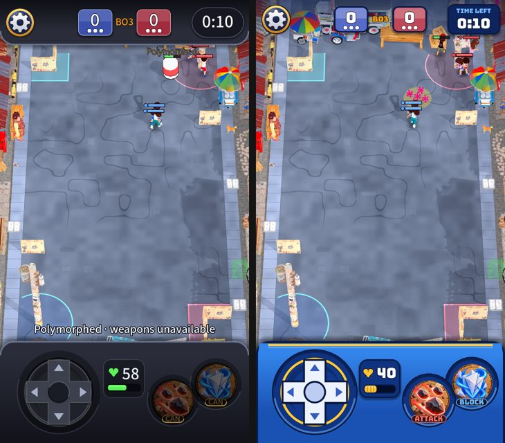

# Gameplay interface rebuilt in Clash Royale style

Owner: "do an interface rebuild at gameplay, make it look more similar to Clash Royale style instead of gameboy". The graphite controller deck and header
read as a game console; Clash Royale's chrome is bright royal blue with thick dark outlines, gold trim and glossy panels, and its top is not a bar at all.

## What changed (all code-drawn; `RoyaleStyle` holds the palette and helpers)
- **Bottom deck:** royal blue (lighter at the top, darker below) in a thick navy outline with a gold trim and a sheen along its rounded top. The control wells are deep blue circles with a navy ring.
- **D-pad:** the Xbox-style cross is kept but restyled: a navy body, a gold rim, a royal blue floor and a cream cross with blue arrow notches; a pressed arm lights gold.
- **Health:** a navy plate in the deck's middle with a heart and the number lettered in white with a navy outline, over a chunky bar marked in tenths like the elixir bar (your colour, amber below half, red below a quarter).
- **Top:** no deck. The gear, the score and the clock float over the street on a soft dark shade (the header is 112 px, was 130). The score cells are glossy panels in a thick navy outline; the clock is a navy panel with TIME LEFT over the time, OVERTIME in gold once the round runs long.
- The tagged message on the deck now reads gold and cream on the blue.

Not changed: layout, sizes, input, the skill buttons (painted art), the health colour rules, the camera framing logic (it reserves the header's new height).

## Not done (needs your art)
The real thing uses painted panels and icons. A painted deck, panel frame, crown and elixir-style bar would be a **2D image** asset for you; the code drawing stays as the fallback.
