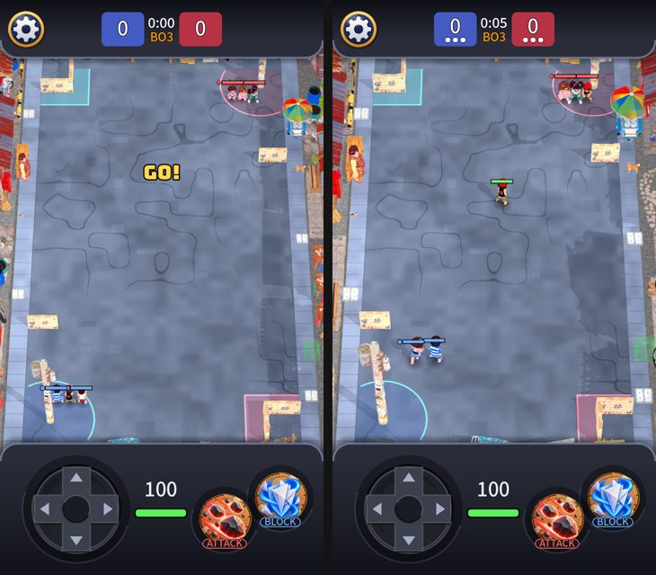

# Scale again, and the gameplay GUI

Owner: "improve scale of models again then improve GUI at gameplay". Built on the tilted 56 degree camera (PR 228) and the world/model scale
audits (PRs 222, 223), which this branch contains.

## Scale
At 1.5x the kids were about 23 px wide on the 720 px base: about two thirds of a 1.5 m floor tile. In the Clash Royale reference a troop is about one tile
wide, so they read small and got lost on the long empty street. **Kids are now 2.0x their model** (about 31 px wide and 53 px tall, a bit under a tile).

Everything else moves with them so the proportions the audit established stay (world factor 2.13 to 2.85, one number: `kid_view_scale`):
- `MapLayout.scenery_scale` 1.7 to 2.27 (houses, shops, vehicles, carts, pets, nanay, end rows), `cover_height` 2.4 to 3.2, `post_height` 11 to 14.
- Gameplay footprints (bases, jail, cover rectangles, hitboxes) are untouched.
- The thrown objects follow the kids (they are drawn `kid_view_scale` times their model): a slipper is now about 2.7x its hit circle's diameter,
  so the test band for that ratio is 0.8 to 2.8 (it was 0.8 to 2.1).
- Bigger lots mean fewer fit along the street, and the shop rotation used to depend on the slot's number, so the barber shop fell out of the row.
  The shopfronts now rotate over the slots beside the play area only, so all of them show whatever the scale.
- End-of-street rows hold five or more things (the rest stand on the road beyond).

## Gameplay GUI
A critique of a match screenshot found three things worth fixing without adding clutter:
1. **Who is tagged was invisible** since the player cards were removed from the tagged screen. **Score pips**: under each team's number in the header, a dot
   per kid, filled while free and hollow while tagged (`Scoreboard.show_roster`). It reads the sim's `tagged` flag; the screen reader says "Kids free: you 2 of 3, them 3 of 3".
2. **Status words** ("Slowed", "Stunned") over a kid at the far end ran under the header and off the street's side. They are now kept under the header and inside the
   screen (`OverheadHud.keep_on_screen`, `top_limit`).
3. The score numbers ride a little above the middle of their cells to leave room for the pips.

Not changed: the deck, the D-pad, the skill buttons, the health bars (92 px x 0.5 stays about one and a half kids wide).

## Check on a phone
Kids and props look bigger, not smaller, than the last build; all three shopfronts show along the sides; pips under both scores; tag one of your kids (Practice
menu: take damage) and one of your pips goes hollow.

Note: the numbers in the [model scale audit](2026-10-21-model-scale.md) were taken at 1.5x (world factor 2.13); the test now holds every prop to the same
band at the new factor (2.85), and the ratios are unchanged because the scenery grew by the same 1.33x.
