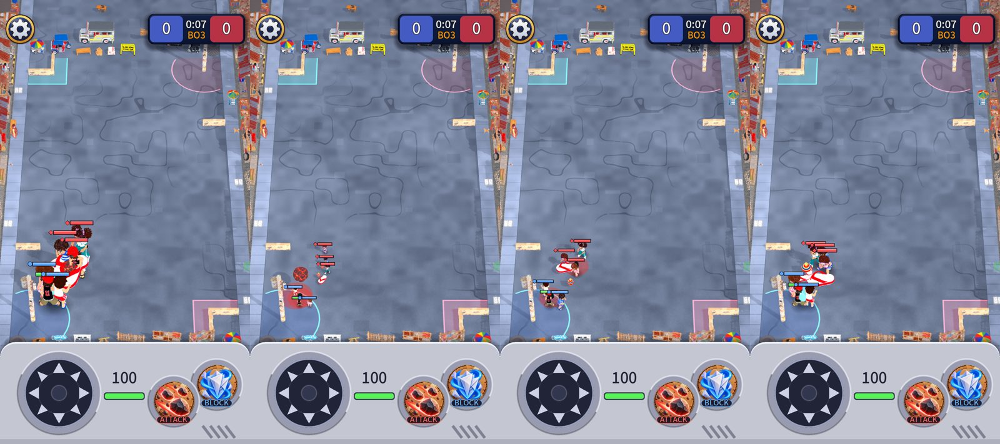
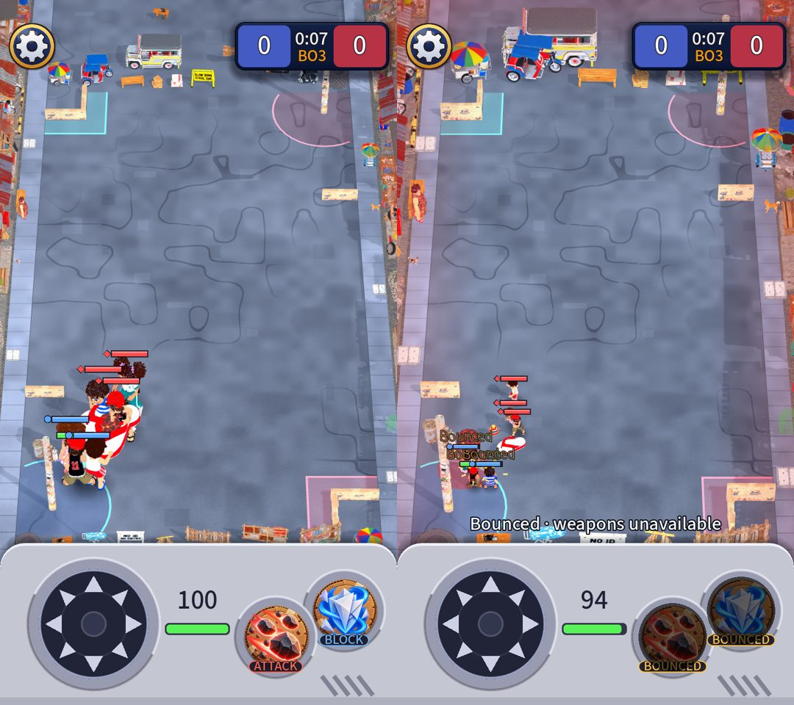

# World scale: kids, props and buildings in proportion

Owner request: rescale the kids, props and buildings to a more realistic scale. Owner choice: shrink the kids (not grow the world alone), chunky toy look
(a house about 3.5 kids, not a photograph).

## What was wrong (measured)
| | Drawn height before | Real | Ratio to a kid before |
| --- | --- | --- | --- |
| Kid | 5.9 m (1.85 m model x 3.2 `kid_view_scale`) | 1.3 m | 1 |
| House / shop | 5.8 m | about 6 m | **1.0**: a kid as tall as a house (a real one is about a fifth) |
| Jeepney | 2.8 m | 2.5 m | 0.5 |
| Nanay | 2.2 m | 1.6 m | **0.4**: a grown-up shorter than half a kid |
| Cardboard cover wall | 1.15 m | 1.2 m | **0.2**: knee high to the kid it should hide |
| Electric post | 8.5 m | 8.5 m | 1.4 |

The kids were drawn 3.2x because the whole street (27 x 48 m) is on one small screen; the props were left at their real size (about 1.4x), so
the kids towered over everything.

## What changed (all data, nothing about play)
- **Kids 3.2x to 1.5x** (`camera_rules.tres: kid_view_scale`), health bars 0.7 to 0.5. A kid is now about 40 px tall and 23 px wide on the 720 x 1280 base.
  A kid's hit circle (0.8 m) now sits much closer to what you see.
- **Scenery x1.7** (`map_layout.tres: scenery_scale`): houses and shops (10 m wide, about 3.5 kids tall), the jeepney, pedicab, carts, the nanay, the pets,
  the drainage covers and the end-of-street props.
- **Cover wall 2.4 m** (`cover_height`, about the kid's height, so it reads as something to hide behind) and **electric post 11 m** (`post_height`).
- The play area, hitboxes, bases, boxes, weapon numbers and every rule are untouched. The main-screen model keeps the true sizes.

## The trade-off, plainly
At the whole-street camera a kid at true size (0.9x, a 1.3 to 1.7 m kid) is about 22 px tall: unreadable. **1.5x is the smallest I would ship**, and it is
already small: about 22 pt tall on a 390 pt wide phone. It is one number (`kid_view_scale`) if you want it a little bigger (1.8 is the next stop) or true size (0.9).
`tests/unit/test_camera_rules.gd` now pins a floor of 36 px tall and 20 px wide so the kids cannot quietly shrink further.

## Side effects to know
- **Fewer end-of-street props fit in a row** (they are bigger): the rest stand on the road beyond the end; every prop is still in the street.
- **The jeepney is big at the top of the screen** and sits behind the score card's corner; the end props are outside the play area, so nothing is hidden in play.
- Status words over clustered kids ("Stunned", "Bounced") overlap more now that the kids are closer to each other on screen.

## Not checked
How it feels on a real phone (the kids are small), and the opening show's fly-around at the new post height (it ran in the headless screenshots without error).
