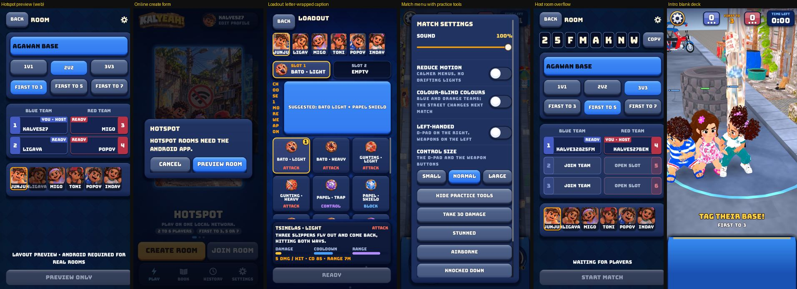

# Interaction audit of every screen (Playwright, web build) and a plan

Owner: "use Playwright to test every interaction with all screens and audit what interactions don't make sense, then plan what is best to remove / change / add. Do it carefully."

## How it was tested
- The real web export (`Web` preset, single-threaded, same as the Pages build) from `main` plus #235, served locally, with the game server running locally (`godot --headless -- --server`) so Online worked end to end.
- Playwright (Chromium) with a **390 x 844 touch phone** (also 360 x 640 and a 1280 x 720 desktop). Taps and drags go through the DevTools touch protocol, so the game receives real `InputEventScreenTouch`/`ScreenDrag`, as on a phone. Two phones at once (host and guest) for the room flows.
- The game draws on one canvas, so there is no DOM to query: the harness `tools/qa/qa_server.js` is a small HTTP remote control (`/open /tap /drag /down /movefinger /up /key /type /wheel /shot /logs`) taking taps in the game's 720 x 1280 design pixels. Rerun with it; every step below is repeatable.
- Software rendering (SwiftShader) is slow: the 3D scenes load in 10 to 30 s and the match clock runs slowly. That is **not** a finding about phones.

Screens and flows covered: boot, Home (3 mode cards, carousel, tabs, profile chip), Hotspot create/join (web), Online create / join / wrong code / partial code / join, the Room (host and guest: team size, first to, JOIN TEAM, character row, copy code, room settings, ready, cancel ready, host leaves), loadout (suggested pair, pick, un-pick, slot switch, character switch), Practice: Play vs bots and Training (intro, first-run coach, D-pad, weapon aim, cast, cooldown, match menu, practice tools, status effects, leave), Book (characters, weapons), History (empty), Settings (every control, how to play, profile dialog), landscape and desktop.

**Not covered** (say so rather than guess): the results card and the weapon-swap picker (covered by unit tests only), real hotspot networking (Android only), reconnect after a dropped connection, a real match won to the end, audio, performance on a real phone, tablets, notch and home-bar insets.

## What works well (keep)
- The 8-way D-pad lights the right arms and the kid stops when the thumb lifts; weapon drag shows a reticle and "RELEASE TO CAST · DRAG TO CANCEL"; a cooldown ring and number appear after a cast.
- Online: a wrong code says "No room with that code", a short code says how many characters are needed, the room code copies with a toast, ready and cancel ready work, the guest sees changes live, a host who leaves hands the room over.
- Loadout: a suggested pair, one tap to take it, stat bars, the character switch keeps your weapons.
- Book and Settings are readable; Settings explains every switch in one line. The rotate-your-phone gate works.

## Findings (what does not make sense)
Severity: **H** blocks or misleads a player, **M** confusing or inconsistent, **L** polish. The picture shows six of them.



| # | Screen | What happens | Why it does not make sense | Sev |
| --- | --- | --- | --- | --- |
| 1 | Home, Hotspot card (web) | The default card's **Create room / Join room** open a dialog "Hotspot rooms need the Android app" (web), with a Preview room that is a disabled screen | The first thing a web player sees as the main action is a dead end; the owner's test channel is the web build | H |
| 2 | Room (host) and the hotspot preview, at 390 wide | The host's room is wider than the screen: the COPY button, the map bar, START MATCH and the Settings dialog are clipped on the right. The guest's room fits. | The extra host-only controls (team size, first to) force the width; the primary button is cut off | H |
| 3 | Loadout, nothing picked | "CHOOSE 2 WEAPONS" is squeezed into a ~40 px column and wraps one letter at a time (CH / OO / SE ...) beside a 280 px tall "SUGGESTED: BATO LIGHT + PAPEL SHIELD" button | The caption is unreadable and the suggestion button is oversized | H |
| 4 | Loadout, un-picking | Tapping a picked weapon un-picks it, the big suggestion button returns and **pushes the whole grid down ~280 px** | A tap right after lands on a different weapon; layout jumps while you are choosing | M |
| 5 | Match, header clock | The chip says **TIME LEFT** but counts **up** (0:00, 0:34 ...) and the match has no time limit; OVERTIME is off (`overtime_after = 0`) so that caption never shows | A wrong label, and a mechanic that does not exist. (Mine, from #234) | H |
| 6 | Match, opening | First-run coach (4 steps) opens **over a live match**: the clock and bots keep going while the player reads; step 1 dims the D-pad it explains | The walkthrough should be a calm moment, not a race | M |
| 7 | Match menu | Opening match settings **does not pause** Practice (clock 0:27 to 0:29 with the menu open). The GDD says it blocks movement but practice keeps running | In a solo mode, opening the menu should stop the game | M |
| 8 | Match menu | "Show practice tools" (Take 30 damage, Stunned, Airborne, Knocked down ...) is in the player-facing menu; opened, the dialog scrolls and **Resume and Leave match fall below the fold** | Developer tools in the main menu; the buttons you need are pushed off | M |
| 9 | Match menu | **Leave match** returns home at once with no confirmation | One mis-tap loses a match and nothing is recorded in History | M |
| 10 | Match intro | A 6 s intro on a **blank blue deck**, cannot be skipped (and the tagged-state deck is the same blue) | A short skip on tap is standard; an empty deck looks broken | M |
| 11 | Status words | The same state has three names: menu "Knocked down", over the kid "KNOCKED OUT", skill tag "DOWN" | Three words for one thing | L |
| 12 | Skill buttons | The two weapon wells **overlap** on the deck | Ambiguous touch area between two skills | M |
| 13 | Settings (touch) | A finger drag that **starts on a card** scrolls only a fraction of the distance; from a title or margin it works. The page is taller than the screen (How to play and Quit game are below the fold) | The cards eat the first touch; on a phone you can think the page cannot scroll. Verify on a real phone (synthetic drags are not a finger) | M |
| 14 | How to play | A sub-page of Settings with **no Back button**; you leave by tapping the lit Settings tab | Every other sub-page has Back | L |
| 15 | Online create and Room | The create form asks Team size, then the **Room asks it again** (the host can change it there) | A redundant step in front of the same choice | M |
| 16 | Online room (3v3 with 1 player) | START MATCH is disabled and the line says only "WAITING FOR PLAYERS"; with a 1v1 room and one player it says "WAITING FOR 1 PLAYER TO READY UP" | The 3v3 line does not say what is missing (players per team) | M |
| 17 | Name fields (Create, Join, Profile) | The default name stays and typed text is **appended** (KALYE527 + Ben = KALYE527BEN); capped at 12 with no hint until the limit; Join and Create have a Name field that duplicates Edit profile | No select-all or clear; three places to set one name | M |
| 18 | Room code boxes | Tapping a box does not move the caret there; typing into a filled code inserts at the caret and drops the rest | Easy to end with the wrong code; there is no Clear button | M |
| 19 | Host leaves | The guest silently becomes **HOST** with the host controls appearing, no notice | A big change with no message | L |
| 20 | Dialogs | Escape closes them; an outside tap was not tested; the opener keeps a white focus ring after a touch | Keyboard focus styling on a touch device | L |
| 21 | Profile dialog + loadout/room | Six faces are picked in the profile and **the same six kids are picked again** for the match | Two parallel "who am I" choices | M |
| 22 | History | The empty state "No battles yet" has no button; leaving a match early records nothing | A dead end instead of "Play" | L |
| 23 | Desktop browser | Any landscape window (every desktop) shows only "Rotate your phone"; no keyboard hint anywhere (WASD, Q/E are in the GDD only) | Desktop players are locked out even though the code supports the keyboard | L |
| 24 | Console | Engine errors `!is_inside_tree()` (can_process) are logged during the Online transitions | Harmless today, noise that hides real errors | L |
| 25 | Docs | The GDD still says "BO3" in the header paragraph and describes the old graphite deck in the controls paragraph | Out of date after #230, #234, #235 | L |

## Plan: what to remove, change, add
Ordered by value for the owner's test channel (the web build) and the competition entry (Android).

### P0: fix what misleads or blocks (small, safe)
1. **Change** the clock label: show "TIME" (counting up) or remove the caption; keep OVERTIME only when the rule is on. (#5)
2. **Change** the host Room layout so it fits 360 to 390 px: stack team size and first-to in two rows or shrink their minimum width; test at 360 x 640, 390 x 844 and a tall 412 x 915. Same for the preview and the dialog. (#2)
3. **Change** the loadout header: put "CHOOSE 2 WEAPONS" on its own line above a normal-height suggestion bar (about 88 px), and reserve the bar's space so un-picking never moves the grid. (#3, #4)
4. **Change** the web Home: make **Practice the default card** on the web build, and hide Hotspot's Create/Join (or label the card "Android app") instead of opening a dead-end dialog. (#1)
5. **Change** Settings touch scrolling: card panels `mouse_filter = PASS` so a drag that starts on a card scrolls; check on a real phone. (#13)

### P1: remove or move what does not belong in the main flow
6. **Remove** "Show practice tools" from the player menu; keep it behind the existing developer switch (`Settings.developer`) so Resume and Leave are always visible. (#8)
7. **Change** Leave match: confirm first ("Leave the match? It will not count"), and record an abandoned match in History. (#9, #22)
8. **Change** Practice: opening the match menu or the coach **pauses the sim** (Practice only; online keeps running). The first-run coach starts before the match, not over it. (#6, #7)
9. **Remove** the duplicate Team size step from the Online create form (set it in the Room), or remove it from the Room and keep it in the form: pick one place. Recommendation: keep it in the Room, where the player sees the slots. (#15)
10. **Remove** the Name field from Create/Join (edit it once in the profile). (#17)

### P2: make the flows understandable
11. **Add** a skip on tap for the intro, and put the controls (dimmed) on the deck during it. (#10)
12. **Change** the Room status line to say what is missing ("Need 3 players per team", "Waiting for Ben to ready up"). (#16)
13. **Change** the name field: select all on focus; code boxes: caret goes to the tapped box, and add a Clear (x) button. (#17, #18)
14. **Add** a toast "You are now the host" and a Back button on How to play. (#14, #19)
15. **Change** the status names to one set (Knocked down, everywhere) and un-overlap the skill wells (spacing, or the second button a little higher). (#11, #12)
16. **Add** an empty-state button on History ("Play a match"). (#22)

### P3: later, needs an owner decision
17. **Decide**: merge the profile face and the match character into one choice (recommended: the face you pick in the profile is your default character in every room). (#21)
18. **Decide**: let desktop browsers play (a portrait letterbox with the keyboard hint) instead of the rotate gate; useful for demos and for this audit. (#23)
19. **Clean**: the `!is_inside_tree()` errors and a GDD refresh (#24, #25).

### Verification for each item
Every change gets a GUT test where it is a rule or a layout floor (the UI lint test already holds sizes), and a Playwright step with the harness in `tools/qa/` so the same click path is repeated before the PR.

## Rerun
```
godot --headless --export-release "Web" build/web/index.html
python3 -m http.server 8765 --directory build/web &
godot --headless -- --server &            # port 8080
node tools/qa/qa_server.js &              # control server on :9300
curl 'localhost:9300/open?url=http://localhost:8765/index.html?server=ws://localhost:8080&w=390&h=844'
curl 'localhost:9300/tap?x=360&y=1100'; curl 'localhost:9300/shot?name=home'
```
