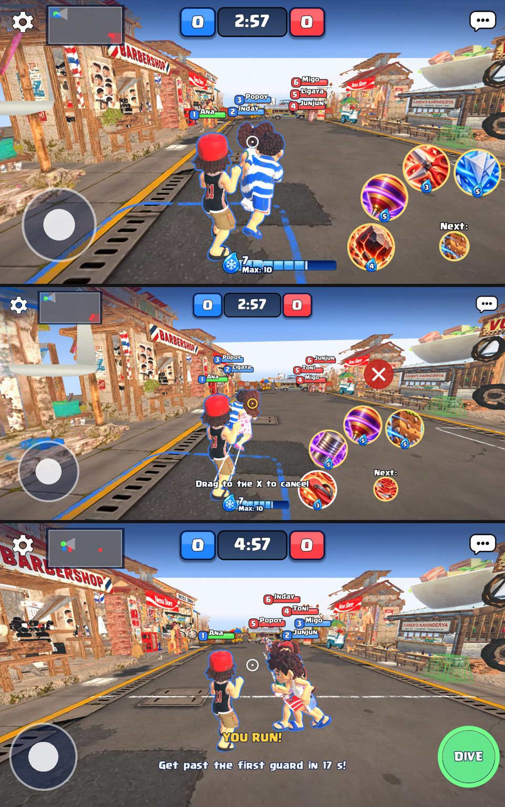
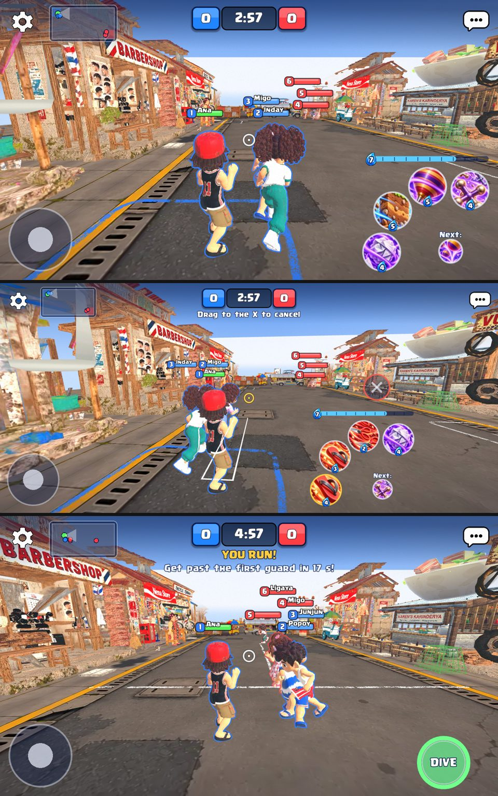

# Landscape match HUD: consistency and calm (2026-11-09)

Owner: "improve and polish consistent style (scale, position, typography, color) of HUD during gameplay so it doesn't add as distraction.
Audit and criticize first, then test after changes to criticize again, then do final changes."

Renders: Godot 4.6.2, Compatibility renderer under Xvfb, 1280 x 720 (16:9) and 1560 x 720 (a 19.5:9 phone on the 720 px landscape base).
States: playing, holding a card, tagged, the match menu, Patintero, a SCORED banner. The shoulder view is the camera (docs/GDD.md
"Shoulder view"). Nothing here was checked on a phone.

## Round 1: what is wrong

The HUD was drawn for a 720 px wide portrait screen and moved onto a 720 px tall landscape one. It now covers about a third of the view, in
four different styles, and its words sit on top of your own kid.

**Scale (the biggest problem)**
1. The score header is 380 x 88 px: 12% of the screen's height, the same as on a portrait phone where height was plentiful.
2. The ability arc's buttons are 116 px across (16% of the height) on a 190 px arc, plus a 72 px NEXT: with the bar they fill the bottom-right
   quarter, where the enemies come from when you run toward their end.
3. The joystick is 184 px across with an 80 px, 85% opaque white thumb: the brightest thing on screen while it does nothing.

**Position**
4. The ice water bar (a 26 px Clash Royale bar, a 56 px drop, the number and a "Max: 10" caption) sits bottom-centre. In the shoulder view that is
   exactly where your own kid stands: the bar is drawn over the kid's feet in every render.
5. Every hint line sits bottom-centre too, over the kid: "Drag to the X to cancel" (24 px, 8 px outline), Patintero's "YOU RUN!" (28 px) and
   "Get past the first guard in 17 s!" (24 px), the tagged panel.
6. The controls do not share a margin: the joystick rests 150 px in, the arc's corner 150 x 110, the street games' knob 26 px from the edge at
   half the pad's height, their action button 26 px from the right. Switching from Agawang Base to Patintero moves the thumbs' controls.
7. The minimap is 14 px from the gear, closer than anything else in the header.

**Typography**
8. Seven text sizes are on screen at once (18, 22, 24, 26, 28, 34, 40 px; 80 for banners) with five outline widths (3 to 8 px) in three inks
   (navy, black, a dark purple). "Next:" is 22 px with a 7 px black outline, the cost numbers 16 px with navy, the hint 24 px with near-black.
9. Far kids' name tags keep their full size in the perspective view: three or four of them stack into one block down the street, louder than
   the kids they name.

**Colour**
10. Four looks for the same kind of thing: the gear and chat are plain white icons, the score cells are saturated blue and red with thick navy
    outlines, the minimap is a hard-edged grey square with a navy frame, the joystick is navy with white, Patintero's DIVE is a solid 132 px
    green disc, the cancel X a solid red disc.
11. The arc's gold rims (4 px) and full-strength card art make all four cards shout equally all the time.

## Plan (one style, kept to the edges)

- **One shared HUD style** (`HudStyle`): one edge margin, one ink (navy) and one outline width per size, a three-size type ramp for the match
  (titles, labels, small labels), one translucent control look (navy fill, cream rim, cream thumb) used by the joystick, the street games' knob,
  the cancel X, the minimap and the empty slots.
- **Scale down for landscape:** the header to 80%, the arc's buttons to 96 px on a 160 px arc, the joystick to 160 px with a see-through thumb,
  the street games' action button to the arc's main spot and size.
- **Move things off your kid:** the ice water bar becomes a slim bar over the arc (the right thumb's cluster), the cancel X above it; the hint
  and the street games' role lines go to the top centre under the score.
- **Same places in every game:** the street games' knob rests where the joystick rests, their action button where the arc turns.
- **Quieter tags far away:** in the shoulder view a kid's name is only drawn when the kid is near; far kids keep the number badge and the bar.

## Round 2: after the first pass (same states, same sizes)

What got better: the header is 80% (304 x 70 px); the arc's buttons are 96 px on a 160 px arc and both thumb clusters end exactly 24 px from
the safe edges; the ice water bar is a 14 px bar over the arc, off your kid; the joystick, the street games' knob, the empty slots and the
cancel X are the same see-through navy with a cream rim; far kids keep only their badge and bar; the minimap is a rounded navy panel.

What was still wrong:
1. The words (the cancel hint, Patintero's "YOU RUN!" line) had moved to the top centre under the tag toast's place, about 190 px down: that
   is the far end of the street in the shoulder view, where the far kids' tags are. They overlapped the tags in both renders.
2. Patintero's DIVE (Tumbang Preso's THROW, KICK, Langit Lupa's LUPA) was still a solid saturated disc with a drop shadow, the loudest thing
   on screen.
3. The gear and the chat button now look large next to the smaller header (88 px touch targets with their icons). Left as they are: the touch
   target is the floor (`UiMetrics.TOUCH`), and the icons are the owner's.

## Round 3: final changes

- The words stand right under the score (6 px), over the sky and the roofs; the tag toast pops in under them for its two seconds.
- The street games' action button keeps its colour, see-through (78%), with the HUD's cream rim and no shadow.

Pinned by `tests/unit/test_hud_style.gd` (margins, places in every game, the bar over the arc, the header scale, the words' place and type,
far names). Still to check on a phone: whether 96 px buttons are easy to hit with a thumb, and whether the see-through controls read in
bright daylight.
